<div align="center">


<h3>Une application multiplateforme pour découvrir, regarder, télécharger et organiser vos animés.</h3>

<p>
  <a href="README.md">English</a> · <a href="README.fr.md"><strong>Français</strong></a>
</p>

<p>
  <a href="https://github.com/loeuf237/animelab/actions/workflows/ci.yml"></a>
  <a href="https://github.com/loeuf237/animelab/releases/latest"></a>
  <a href="LICENSE"></a>
  <a href="https://t.me/AnimeLabGroup"></a>
  <a href="https://t.me/animelabchannel"></a>
</p>

</div>

**AnimeLab** associe un moteur **Python / FastAPI** à une interface **Vue 3 / TypeScript** et aux outils multimédias intégrés (FFmpeg / ffprobe). L’application fonctionne nativement sur **Windows**, **Linux**, **macOS**, **Android**, ou en serveur auto-hébergé **Docker / Web / PWA**.

> Premier lancement ? Consultez le [guide de configuration initiale et de mises à jour](docs/startup-and-updates.md) (apparence, choix du dossier de stockage, permissions Android et mises à jour).

---

## Nouveautés de la v0.2.0

La **[`v0.2.0`](docs/releases/v0.2.0.md)** est la **première version majeure** d’AnimeLab :

- **Mises à jour intégrées & vérification SHA-256 :** recherchez les nouvelles versions dès le démarrage ou dans **Paramètres → Général**, vérifiez l’intégrité avec `SHA256SUMS.txt`, lancez l’installation sur Android via `PackageInstaller` ou téléchargez et extrayez l’archive Desktop directement dans l’application.
- **Double moteur d’extensions Aniyomi/Anikku & Seanime JS/V8 :** exécutez des dépôts APK Aniyomi ainsi que des extensions JavaScript/TypeScript Seanime grâce au moteur V8 embarqué (`mini-racer`) sur Desktop/Serveur, avec prise en charge complète de la nouvelle base d’épisodes d’Anime-Sama (`lien:` / `epsJeton` / `/api/lien.php`) et des en-têtes compatibles Bot-Guard (notamment Codeberg).
- **Fiche animé repensée en modes Sombre & Clair :** arrière-plan de jaquette flouté harmonieux et contrastes adaptés sur l’ensemble des 5 palettes (`Classique`, `Turquoise`, `Violet`, `Ambre`, `AMOLED`).
- **Téléchargements en lot fiabilisés :** séparation stricte des éditions VF / VOSTFR / VO, protection contre les doublons et résolution multi-saisons améliorée.

---

## Aperçu visuel

<p align="center">
  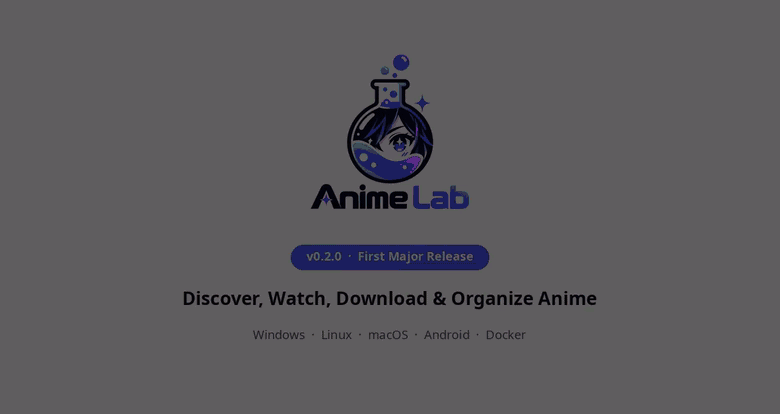
</p>

<p align="center">
  <em>Parcours v0.2.0 : Bibliothèque & Accueil → Recherche instantanée (<code>Ctrl+K</code>) → Téléchargement par lot VF & Sous-titres → File active → Lecteur vidéo intégré → Thèmes, Mises à jour & Diagnostics → Extensions Aniyomi & Seanime → Mode Clair, Bascule FR/EN & Fiche v0.2.0 — <a href="docs/showcase/animelab-demo.mp4"><strong>Voir la vidéo HD MP4 complète</strong></a>.</em>
</p>

<details>
<summary><strong>Captures d’écran : ordinateur, thèmes, extensions et Android</strong></summary>

| Accueil (Mode Sombre) | Recherche rapide (`Ctrl + K`) |
| :---: | :---: |
| 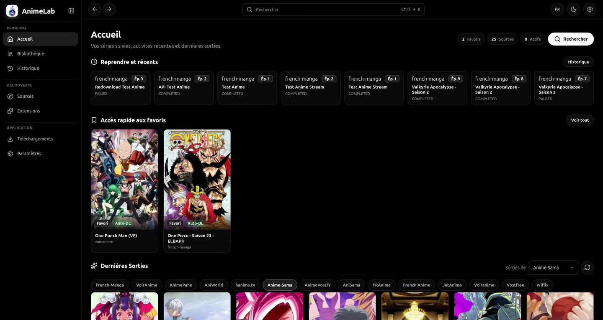 | 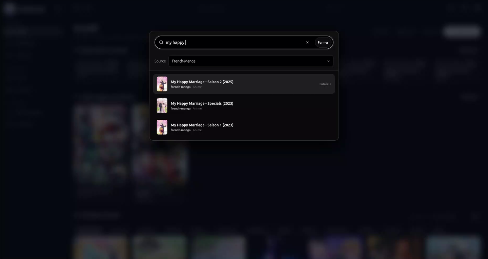 |
| **Fiche animé Mode Clair v0.2.0 (Fond flouté)** | **Sélection par lot (VF / VOSTFR / Sous-titres)** |
| 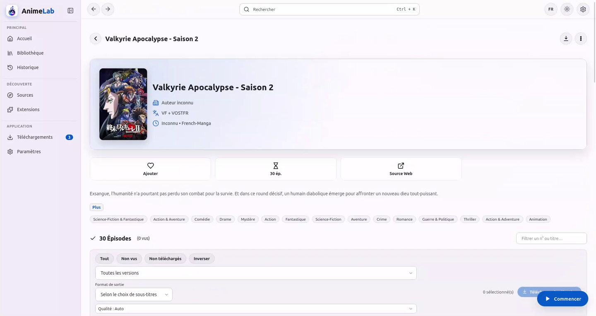 | 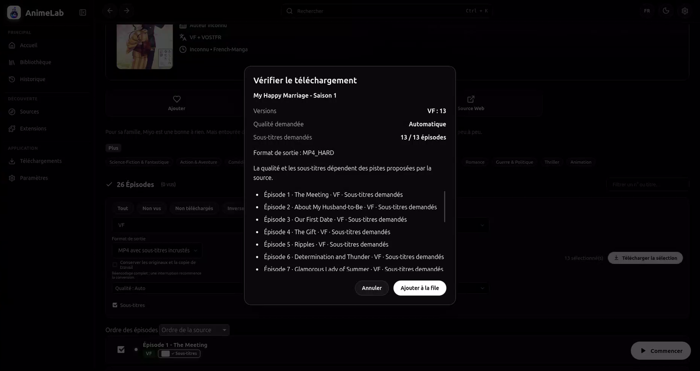 |
| **File de téléchargements en direct** | **Bibliothèque & Suivi automatique (`Auto-DL`)** |
| 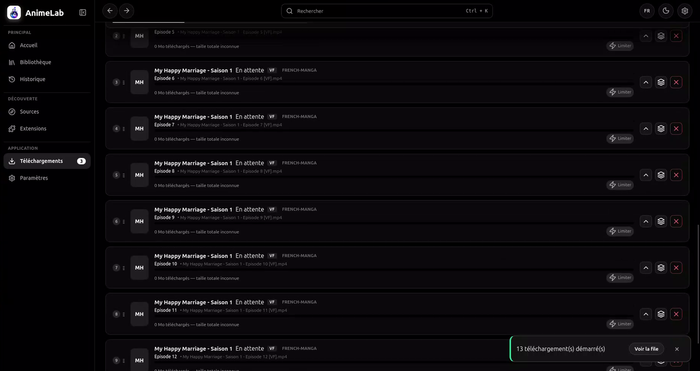 | 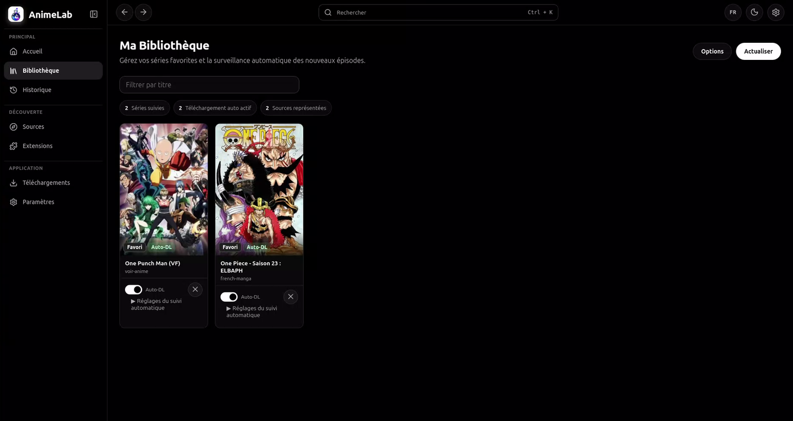 |
| **Explorateur d’extensions Seanime JS/V8 & Aniyomi** | **Palettes de thèmes Sombre & Clair** |
| 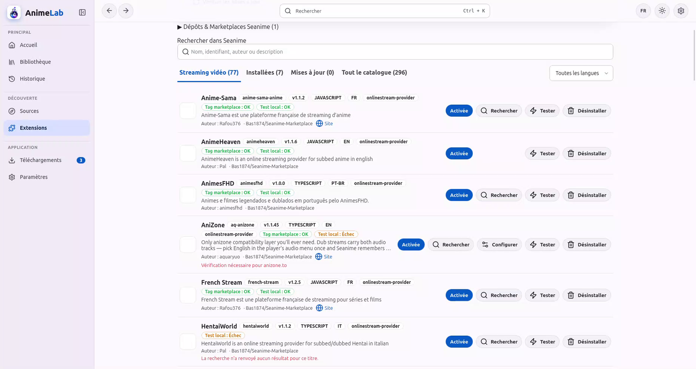 | 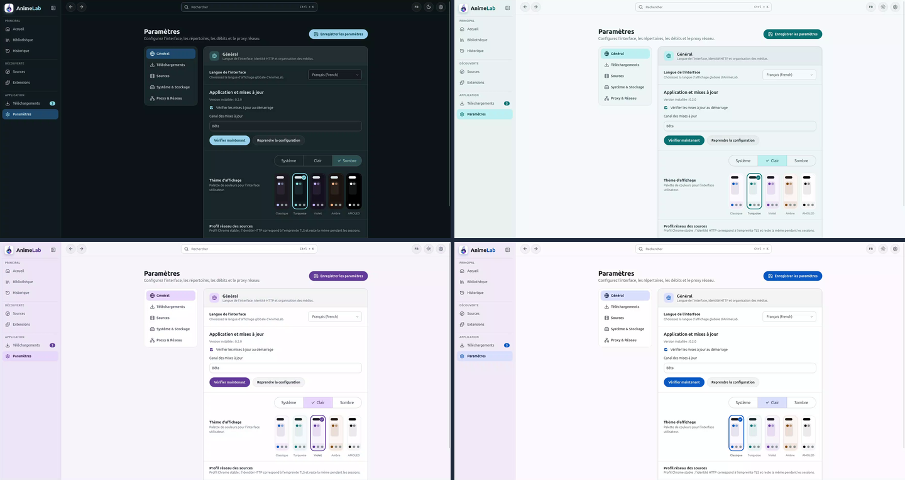 |

| Console d’administration Desktop |
| :---: |
|  |

### Interface Mobile & Android

<p align="center">
  
</p>

</details>

<details>
<summary><strong>GIFs ciblés par fonctionnalité</strong></summary>

#### 1. Recherche rapide, sélection VF/Sous-titres, file d’attente et lecture vidéo
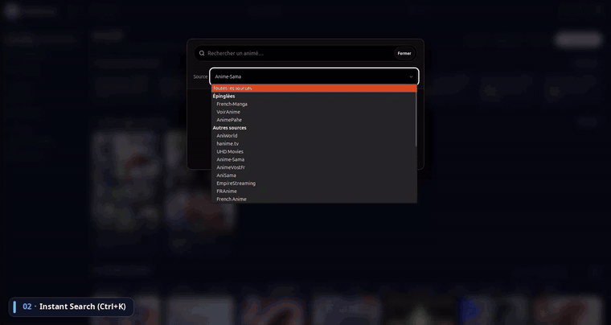

#### 2. Thèmes, diagnostics, proxys, extensions Aniyomi & Seanime et Mode Clair
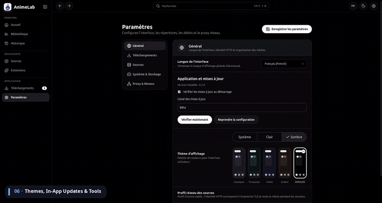

</details>

---

## Téléchargements et mises à jour intégrées

Téléchargez les paquets depuis les **[releases GitHub (`v0.2.0`)](https://github.com/loeuf237/animelab/releases/latest)** ([notes de version v0.2.0](docs/releases/v0.2.0.md)). Les versions ordinateur, l’APK Android et les empreintes `SHA256SUMS.txt` sont publiés ensemble dans la même release.

| Plateforme | Paquet (`v0.2.0`) | Démarrage |
| --- | --- | --- |
| **Windows** x64 | `AnimeLab-v0.2.0-Windows-x64.zip` | Extrayez toute l’archive ZIP puis lancez `AnimeLab.exe`. |
| **Linux** x64 | `AnimeLab-v0.2.0-Linux-x64.tar.gz` | Extrayez l’archive puis exécutez `./AnimeLab` (nécessite glibc 2.35+, ex. Ubuntu 22.04+). |
| **macOS** Apple Silicon / Intel | `AnimeLab-v0.2.0-macOS-arm64-UNTESTED.zip`<br>`AnimeLab-v0.2.0-macOS-x64-UNTESTED.zip` | Choisissez l’archive correspondant à votre processeur et ouvrez `AnimeLab.app`. **NON TESTÉ sur Mac physique ; application non signée et non notariée.** |
| **Android** 10+ ARM64 | `AnimeLab-v0.2.0-Android-arm64.apk` | APK autonome signé (moteur Python et interface Vue inclus) ; aucun serveur PC requis. |
| **Navigateur / Docker / PWA** | Serveur auto-hébergé | Lancez `python run.py` ou `docker compose up -d --build --wait`, puis ouvrez `http://localhost:8080/app/`. |

### Détails par plateforme et mises à jour

- **Paquets desktop :** incluent Python, l’interface Vue compilée, `curl_cffi`, `yt-dlp`, FFmpeg et ffprobe. Windows s’appuie sur Edge WebView2 ; Linux utilise GTK/WebKit avec bascule automatique vers le navigateur système si aucune fenêtre native n’est disponible. Voir le [guide des outils desktop et de récupération](docs/desktop-distribution.md).
- **Application Android autonome :** embarque le moteur Python 3.13 / Chaquopy et l’interface web hors ligne. Les vidéos terminées sont exportées vers le stockage partagé (`Downloads/AnimeLab` ou un dossier choisi via SAF) ; un export échoué peut être relancé sans retélécharger. Voir le [guide de distribution et stockage Android](docs/android-distribution.md).
- **Mises à jour in-app (`v0.2.0`) :** AnimeLab vérifie les versions au démarrage (si l’option est active) ou à la demande dans **Paramètres → Général**, distingue les canaux stable et bêta, vérifie les empreintes contre `SHA256SUMS.txt`, confie l’installation Android à `PackageInstaller` et télécharge/extrait automatiquement les archives desktop.
- **PWA :** depuis un navigateur compatible sur ordinateur ou mobile, installez l’interface via **Installer** ou **Ajouter à l’écran d’accueil** (le serveur AnimeLab doit rester accessible).

---

## Démarrer l’application sur ordinateur

**Si votre dossier contient `desktop.py`, `pyproject.toml` et un répertoire `animelab/`, vous disposez du code source.** Ouvrez un terminal dans ce dossier et exécutez :

```bash
uv run --locked --group desktop python desktop.py
```

Sous Linux, vous pouvez également exécuter **`./launcher.sh`** à la racine du dépôt (`./launcher.sh --help` pour l’état, l’arrêt et l’autotest). Le script installe les dépendances desktop verrouillées et compile l’interface si besoin. Consultez [Exécuter depuis les sources](#exécuter-depuis-les-sources) pour les prérequis.

Les instructions ci-dessous s’appliquent aux **archives téléchargées depuis les releases** (qui incluent déjà Python et l’interface compilée) :

### Linux

Extrayez `AnimeLab-v0.2.0-Linux-x64.tar.gz`, ouvrez un terminal dans le dossier extrait contenant `AnimeLab` et lancez :

```bash
chmod +x AnimeLab
./AnimeLab
```

### Windows

Extrayez `AnimeLab-v0.2.0-Windows-x64.zip` et double-cliquez sur **`AnimeLab.exe`**, ou exécutez dans PowerShell depuis le dossier extrait :

```powershell
.\AnimeLab.exe
```

### Utiliser le launcher

1. Le **launcher natif à onglets** s’ouvre en premier (`Général`, `Téléchargements`, `Sources`, `Extensions`, `Authentification`, `Proxys`, `Sauvegardes`, `Diagnostics`).
2. Choisissez le mode d’ouverture (**Fenêtre native** ou **Navigateur** installé), le port et le dossier de téléchargement, puis cliquez sur **Launch**.
3. Ouvrez l’adresse affichée par le launcher (si le port choisi est occupé, AnimeLab en sélectionne un autre libre automatiquement).
4. Fermer la fenêtre du launcher laisse le serveur en service ; cliquez sur **Stop** pour un arrêt propre.
5. Rouvrez le launcher avec `./AnimeLab --admin` (Linux) ou `.\AnimeLab.exe --admin` (Windows PowerShell), ou utilisez `--launch` pour démarrer directement avec vos préférences enregistrées.

---

## Fonctionnalités principales

- **Parcourir & Rechercher (`Ctrl+K` / `Cmd+K`) :** sources intégrées **French-Manga**, **VoirAnime** et **AnimePahe** ainsi que les sources Aniyomi et Seanime importées, rubriques **Dernières Sorties** par source, filtres par genre/tag et recherche rapide multi-sources.
- **Lecteur vidéo intégré :** streaming direct ou lecture de fichiers locaux avec sélection de qualité, menus audio et sous-titres, reprise automatique de position et bouton **Épisode suivant**.
- **Téléchargements en lot & File active :** lancez un épisode ou une saison complète (`VF`, `VOSTFR`, `VO`), choisissez le profil de sortie (`MP4 sous-titres incrustés`, `MKV`, etc.), réordonnez la file par glisser-déposer, mettez en pause/reprenez à tout moment, limitez le débit global et contrôlez l’intégrité des fichiers.
- **Séparation stricte des versions & anti-doublon :** VF, VOSTFR et VO disposent d’identités et de noms de fichiers distincts afin de ne jamais s’écraser mutuellement.
- **Bibliothèque & Suivi automatique (`Auto-DL`) :** favoris, historique de lecture/téléchargement, surveillance automatique des nouveaux épisodes (`Auto-DL`), organisation optionnelle compatible Plex / Jellyfin et export résilient sur Android.
- **Personnalisation, Diagnostics & Proxys :** thèmes système / clair / sombre avec **5 palettes de couleurs** (`Classique`, `Turquoise`, `Violet`, `Ambre`, `AMOLED`), bascule instantanée **FR / EN**, export de diagnostics & jauge d’espace disque, plus pool automatique de proxys HTTPS et configuration `SOCKS5` / `HTTP`.

---

## Sources et extensions

AnimeLab regroupe plusieurs moteurs d’extensions dans **Sources → Extensions** :

1. **Dépôts Aniyomi / Anikku / Animiru :**
   - Importez et actualisez plusieurs dépôts simultanément tout en conservant vos versions et recettes personnalisées.
   - **Desktop / Serveur :** extrait les sélecteurs DEX, URL et constantes de requêtes depuis les APK et exécute des plans sérialisables `SourceRecipe` via un interpréteur Python commun (épisodes AJAX, catalogues JSON, tableaux de lecteurs littéraux, HTML et base `lien:` / `epsJeton` d’Anime-Sama). Le bytecode Kotlin arbitraire ou chiffré n’est pas exécuté sur PC — consultez [l’exécution des recettes et ses limites](docs/extension-recipes.md).
   - **Android :** les builds de validation intègrent un hôte d’exécution isolé (`:extension-runtime`) pour les APK approuvés explicitement ; voir [l’utilisation et l’état de validation](docs/studies/aniyomi-anikku/UTILISATION.md).
2. **Extensions Seanime (JavaScript / TypeScript) :**
   - Moteur **V8 (`mini-racer`)** intégré sur Desktop/Serveur (`seanime_runtime.py`) pour parcourir les catalogues/marketplaces Seanime, installer des extensions, lancer des tests locaux de recherche et lire ou télécharger des épisodes.
   - Un premier pont `WebView` hors écran existe sur Android et fait l’objet de l’issue [#63](https://github.com/loeuf237/animelab/issues/63).
3. **CloudStream (`.cs3`) & Extracteurs d’hébergeurs (Feuille de route) :**
   - Prise en charge `.cs3` sur PC ([#64](https://github.com/loeuf237/animelab/issues/64)) et Android ([#65](https://github.com/loeuf237/animelab/issues/65)), amélioration du moteur de recettes Anikku/Animiru ([#61](https://github.com/loeuf237/animelab/issues/61)) et nouveaux extracteurs d’hébergeurs vidéo ([#62](https://github.com/loeuf237/animelab/issues/62)).

Lorsqu’un site demande une vérification anti-bot, AnimeLab propose une ouverture encadrée avec capture de cookies (`docs/browser-verification.md`) ainsi que le routage par proxy dans **Paramètres → Proxy & Réseau**. La capture automatique par WebView système temporaire façon Mihon/Anikku sur Android et l’amélioration de la vérification sur PC sont suivies dans [#69](https://github.com/loeuf237/animelab/issues/69) et [#70](https://github.com/loeuf237/animelab/issues/70).

---

## Serveur partagé et comptes

Un mode serveur partagé optionnel offre des comptes gérés par l’administrateur, des codes d’invitation et de récupération, des permissions ainsi que des bibliothèques, sessions de sources et téléchargements privés par utilisateur. Il s’exécute depuis les sources ou Docker, et peut aussi être activé en local dans l’onglet **Authentication** du launcher desktop. Le mode personnel reste le défaut. Consultez la [configuration et sécurité du serveur partagé](docs/shared-server.md).

---

## Exécuter depuis les sources

Prérequis :

- **Python 3.12 ou 3.13** (tous deux vérifiés en CI ; `.python-version` pointe sur `3.13`)
- **Node.js 22 LTS (22.13+)** et **npm**
- **FFmpeg** et **ffprobe** sur le `PATH`
- **uv 0.13.1** ([guide d’installation](https://docs.astral.sh/uv/getting-started/installation/))

Clonez le dépôt et installez l’environnement Python verrouillé :

```bash
git clone https://github.com/loeuf237/animelab.git
cd animelab
uv sync --locked
```

Installez les dépendances frontend et compilez l’interface Vue :

```bash
cd frontend
npm ci
npm run build
cd ..
```

Recompilez le frontend (`npm run build`) après toute modification dans `frontend/`.

### Launcher desktop depuis les sources (Linux & Windows)

```bash
uv sync --locked --group desktop
uv run --locked --group desktop python desktop.py
```

### Serveur web depuis les sources

```bash
uv run --locked python run.py
```

Ouvrez **[http://localhost:8080/app/](http://localhost:8080/app/)**. Les anciennes routes (`/downloads`, `/settings`, `/anime`, `/search`, etc.) redirigent automatiquement vers l’application Vue en conservant les paramètres de requête.

### Configuration et variables d’environnement

Les paramètres de l’interface gèrent la langue, les thèmes, les téléchargements, les sources et les proxys. Depuis les sources ou un serveur, des variables d’environnement permettent de surcharger la configuration :

| Variable | Rôle | Valeur par défaut |
| --- | --- | --- |
| `ANIMELAB_HOST` | Adresse d’écoute du serveur | `127.0.0.1` |
| `ANIMELAB_PORT` | Port HTTP | `8080` |
| `ANIMELAB_ALLOWED_HOSTS` | Hôtes HTTP acceptés (séparés par des virgules, sans protocole ni port) | `127.0.0.1,localhost` |
| `ANIMELAB_DOWNLOAD_DIR` | Dossier de destination des téléchargements | `~/Downloads/AnimeLab` |
| `ANIMELAB_RELOAD` | Rechargement automatique du serveur de développement | `true` |
| `ANIMELAB_CHROMIUM_PATH` | Exécutable Chromium (ou dérivé) pour la vérification manuelle | Détection automatique |
| `ANIMELAB_CHROMIUM_HEADLESS` | Lancer Chromium de vérification en mode headless | `false` |

> **Sécurité des hôtes :** seuls les hôtes locaux sont acceptés par défaut (les autres reçoivent HTTP 400). Pour un accès réseau local ou via reverse proxy, renseignez `ANIMELAB_ALLOWED_HOSTS` (ex. `127.0.0.1,localhost,192.168.1.50,anime.example.org`). Les sous-domaines (`*.example.org`) sont pris en charge ; évitez `*`.
>
> **Compatibilité héritée :** AnimeLab s’appelait auparavant **Animan**. Le paquet Python est `animelab`, les variables `ANIMELAB_*` sont prioritaires tout en acceptant les alias `ANIMAN_*`, et le dossier de données `~/.animan` ainsi que l’identifiant Android `com.animan.app` sont conservés pour préserver les bibliothèques existantes (`docs/legacy-identifiers.md`).

Pour exécuter localement sans rechargement automatique (Linux/macOS) :

```bash
ANIMELAB_HOST=127.0.0.1 ANIMELAB_RELOAD=false uv run --locked python run.py
```

---

## Docker

Avec Docker Engine et Compose installés :

```bash
docker compose up -d --build --wait
```

Ouvrez **[http://localhost:8080/app/](http://localhost:8080/app/)**. Le conteneur inclut le moteur Python, l’interface Vue compilée, FFmpeg et des volumes persistants nommés. Arrêtez-le avec `docker compose down`. Consultez le [guide Docker](docs/docker.md) pour monter vos dossiers de téléchargement sur l’hôte, effectuer des sauvegardes et configurer l’accès réseau.

---

## Communauté et contribuer à AnimeLab

Les contributions en **français ou en anglais** sont les bienvenues : code, tests sur appareils Android, maquettes d’interface, signalements de bugs, recettes de sources ou documentation !

- **Entraide & Communauté :** **[Telegram — Groupe AnimeLab](https://t.me/AnimeLabGroup)**
- **Annonces de versions :** **[Telegram — Chaîne AnimeLab](https://t.me/animelabchannel)**
- **Idées & Questions :** **[Discussions GitHub](https://github.com/loeuf237/animelab/discussions)**
- **Contact mainteneur :** [Telegram — @loeuf237](https://t.me/loeuf237) *(consignez les décisions techniques publiquement sur GitHub)*

### Priorités après la v0.2.0

Consultez l’**[issue de suivi #12](https://github.com/loeuf237/animelab/issues/12)** et les **[priorités détaillées de contribution](docs/contribution-priorities.md)** pour les fiches complètes. Chantiers prioritaires actuels :

- **Extensions & Extracteurs :** corriger les extensions Anikku/Animiru dans le moteur de recettes ([#61](https://github.com/loeuf237/animelab/issues/61)), élargir les extracteurs d’hébergeurs vidéo ([#62](https://github.com/loeuf237/animelab/issues/62)), stabiliser le moteur Seanime JS/V8 sur Android ([#63](https://github.com/loeuf237/animelab/issues/63)) et décoder/exécuter les extensions CloudStream (`.cs3`) sur PC ([#64](https://github.com/loeuf237/animelab/issues/64)) & Android ([#65](https://github.com/loeuf237/animelab/issues/65)).
- **Vérification des sources :** WebView système temporaire façon Mihon/Anikku avec capture automatique de cookies sur Android ([#69](https://github.com/loeuf237/animelab/issues/69)) et amélioration de la vérification sur PC ([#70](https://github.com/loeuf237/animelab/issues/70)).
- **Onglet Outils sur PC :** Atelier de sous-titrage complet ([#66](https://github.com/loeuf237/animelab/issues/66)) et atelier de transcription audio vers sous-titres avec Whisper / TurboScribe ([#67](https://github.com/loeuf237/animelab/issues/67)).
- **Bons points d’entrée (`good first issue`) :**
  - Invitation au groupe Telegram au premier lancement & section À propos ([#71](https://github.com/loeuf237/animelab/issues/71))
  - Ajout automatique à la bibliothèque lors d’un appui sur une carte d’animé ([#68](https://github.com/loeuf237/animelab/issues/68))
  - Raccourcis clavier & Picture-in-Picture ([#51](https://github.com/loeuf237/animelab/issues/51)) · Discord Rich Presence optionnel sur Desktop ([#74](https://github.com/loeuf237/animelab/issues/74))
  - Modèles de nommage Plex / Jellyfin / Kodi ([#78](https://github.com/loeuf237/animelab/issues/78)) · Vérification automatisée i18n ([#58](https://github.com/loeuf237/animelab/issues/58)) · Découpage de bundle Vite ([#57](https://github.com/loeuf237/animelab/issues/57))
  - Guide illustré Linux ([#21](https://github.com/loeuf237/animelab/issues/21)) · Nouvelle palette de thème ([#28](https://github.com/loeuf237/animelab/issues/28))

Lisez les guides **[Première contribution](docs/first-contribution.md)** et **[CONTRIBUTING.md](CONTRIBUTING.md)** ([English](CONTRIBUTING.en.md)) avant d’ouvrir une Pull Request.

### Développement local et vérifications CI

Pour développer l’interface Vue avec rechargement à chaud tout en gardant le moteur Python actif sur le port `8080` :

```bash
cd frontend
npm run dev
```

Vite sert l’interface sur **http://localhost:5173** et redirige les appels `/api` vers le port `8080`.

Pour lancer la suite complète de validation correspondant à [`.github/workflows/ci.yml`](.github/workflows/ci.yml) (Ruff, mypy, ESLint, Prettier, build Vue/TypeScript, tests Python 3.12/3.13 et tests Playwright) :

```bash
cd frontend
npx playwright install --with-deps chromium
cd ..
uv run --locked python scripts/check.py all
```

Pour exécuter uniquement les tests Python (après avoir compilé `frontend/dist`) :

```bash
uv run --locked python scripts/check.py python
```

Les dépendances Python sont verrouillées dans `uv.lock` (export runtime dans `requirements.txt`), et les dépendances frontend dans `frontend/package-lock.json`. Le moteur Python se trouve dans `animelab/` et le packaging desktop utilise `animelab.spec` — voir les [notes sur le nom du paquet](docs/package-namespace.md) et le [guide de développement](docs/development.md).

---

## Index de la documentation

- **Installation & Plateformes :** [Démarrage initial & mises à jour](docs/startup-and-updates.md) · [Distribution desktop](docs/desktop-distribution.md) · [Distribution & stockage Android](docs/android-distribution.md) · [Guide Docker](docs/docker.md) · [Serveur partagé](docs/shared-server.md)
- **Extensions & Réseau :** [Recettes d’extensions & limites](docs/extension-recipes.md) · [Étude & état Aniyomi/Anikku](docs/studies/aniyomi-anikku/README.md) · [Vérification navigateur & cookies](docs/browser-verification.md) · [Étude fournisseurs de proxys](docs/proxy-providers.md)
- **Contribution & Architecture :** [Priorités de contribution (FR)](docs/contribution-priorities.md) · [Première contribution (FR)](docs/first-contribution.md) · [Guide de développement](docs/development.md) · [Validation interface mobile](docs/mobile-ui.md) · [Diagrammes d’architecture UML](docs/architecture/README.md)
- **Releases & Ressources :** [Notes de version](docs/releases/) · [Identité visuelle](docs/branding/README.md) · [Anciens identifiants](docs/legacy-identifiers.md)

---

## Licence

AnimeLab est un logiciel libre publié sous **GNU General Public License, version 3 uniquement** (`GPL-3.0-only`). Vous êtes libre de l’utiliser, de le modifier et de le redistribuer selon ces termes ; toute version modifiée redistribuée doit respecter la GPLv3 et fournir le code source correspondant. Ce logiciel est fourni sans garantie.

Consultez [LICENSE](LICENSE), [NOTICE](NOTICE) et les [notices des composants tiers Android](android/app/src/main/assets/THIRD-PARTY-NOTICES.txt) pour les détails complets de licence.
