<div align="center">


<h3>A cross-platform application for discovering, watching, downloading, and organizing anime.</h3>

<p>
  <a href="README.md"><strong>English</strong></a> · <a href="README.fr.md">Français</a>
</p>

<p>
  <a href="https://github.com/loeuf237/animelab/actions/workflows/ci.yml"></a>
  <a href="https://github.com/loeuf237/animelab/releases/latest"></a>
  <a href="LICENSE"></a>
  <a href="https://t.me/AnimeLabGroup"></a>
  <a href="https://t.me/animelabchannel"></a>
</p>

</div>

**AnimeLab** combines a **Python / FastAPI** engine with a **Vue 3 / TypeScript** interface and integrated media tooling (FFmpeg / ffprobe), running natively on **Windows**, **Linux**, **macOS**, **Android**, or as a self-hosted **Docker / Web / PWA** server.

> New to AnimeLab? See the [first-run setup and update guide (French)](docs/startup-and-updates.md) for onboarding, themes, storage selection, Android permissions, and in-app updates.

---

## What's New in v0.2.0

**[`v0.2.0`](docs/releases/v0.2.0.md)** is the **first major release** of AnimeLab:

- **In-app release updates & SHA-256 verification:** check for updates from startup onboarding or **Settings → General**, verify downloads against `SHA256SUMS.txt`, trigger Android `PackageInstaller` self-updates, or download & extract desktop archives right inside the app.
- **Dual Aniyomi/Anikku & Seanime JS/V8 extension engines:** run Aniyomi APK repositories alongside JavaScript/TypeScript Seanime extensions via an embedded V8 (`mini-racer`) runtime on Desktop/Server, plus full support for Anime-Sama's `lien:` / `epsJeton` / `/api/lien.php` episode database and Bot-Guard-compatible headers (e.g., Codeberg).
- **Reworked Dark & Light Anime Detail Hero Card:** blurred ambient cover backdrop and high-contrast theme tokens across all 5 palettes (`Classic`, `Teal`, `Lavender`, `Amber`, `AMOLED`).
- **Cleaner batch downloads & path isolation:** strict VF / VOSTFR / VO identity separation, duplicate-download prevention, and improved multi-season resolution.

---

## Visual Overview

<p align="center">
  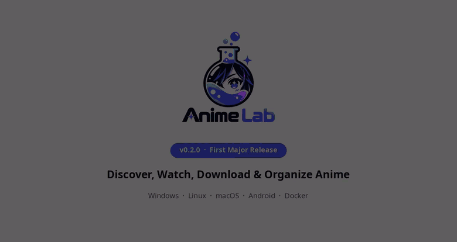
</p>

<p align="center">
  <em>v0.2.0 Walkthrough: Library & Auto-DL → Instant Search (<code>Ctrl+K</code>) → Batch VF & Subtitles Download → Live Queue → Built-in Video Player → Themes, In-App Updates & Diagnostics → Aniyomi & Seanime Extensions → Light Mode, EN/FR Switcher & v0.2.0 Hero Card — <a href="docs/showcase/animelab-demo.mp4"><strong>Watch full HD MP4 video</strong></a>.</em>
</p>

<details>
<summary><strong>Screenshots: Desktop, Themes, Extensions & Android</strong></summary>

| Home Dashboard (Dark) | Quick Search (`Ctrl + K`) |
| :---: | :---: |
| 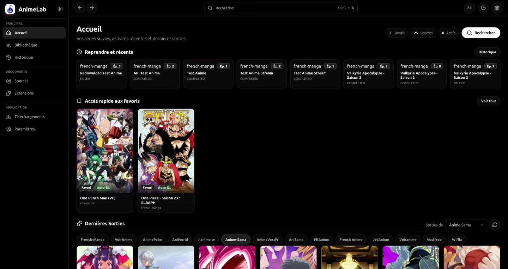 | 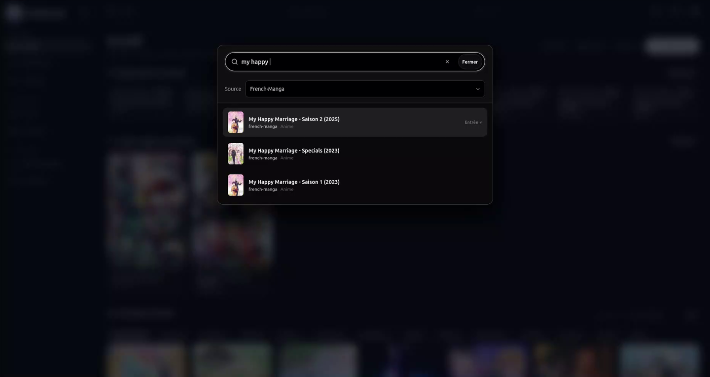 |
| **v0.2.0 Light Hero Card (Ambient Cover)** | **Batch Selection (VF / VOSTFR / Subtitles)** |
| 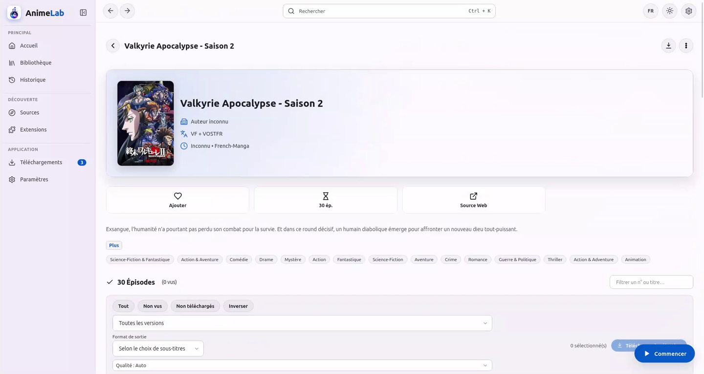 | 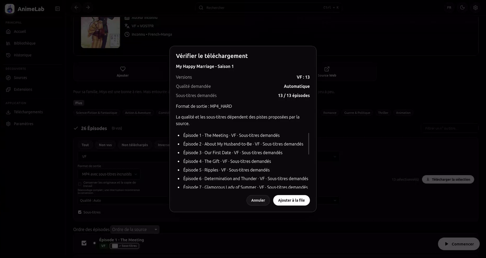 |
| **Live Download Queue & Progress** | **Library & Automatic Tracking (`Auto-DL`)** |
| 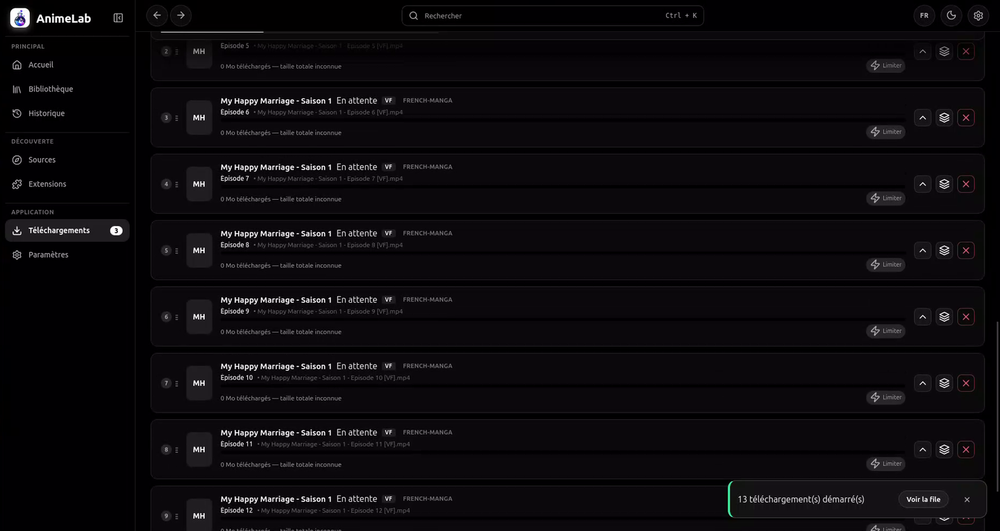 | 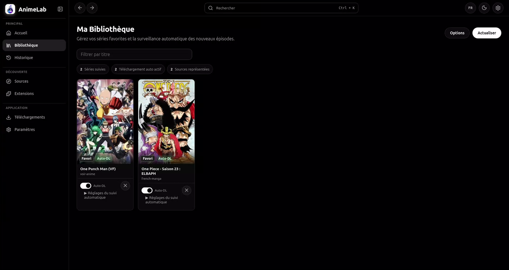 |
| **Seanime JS/V8 & Aniyomi Extensions Explorer** | **Dark & Light Theme Palettes** |
| 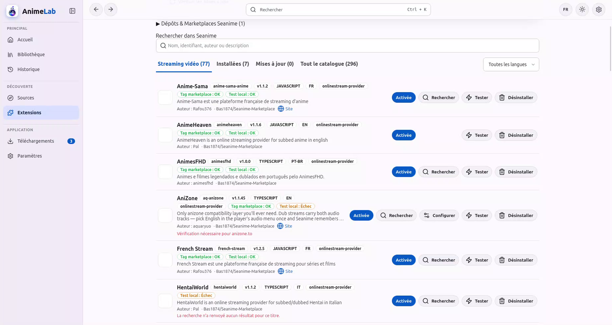 | 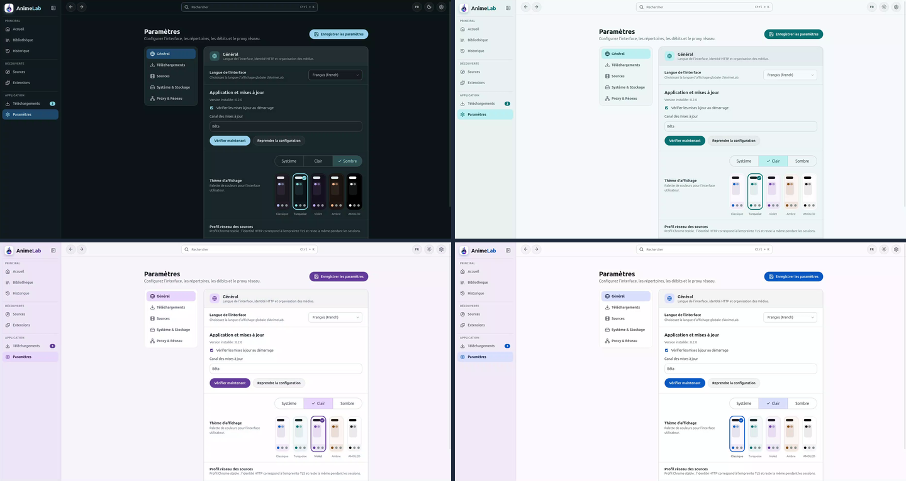 |

| Desktop Administration Console |
| :---: |
|  |

### Mobile & Android UI

<p align="center">
  
</p>

</details>

<details>
<summary><strong>Feature-specific GIFs</strong></summary>

#### 1. Instant Search, Batch VF/Subtitle Selection, Queue & Playback
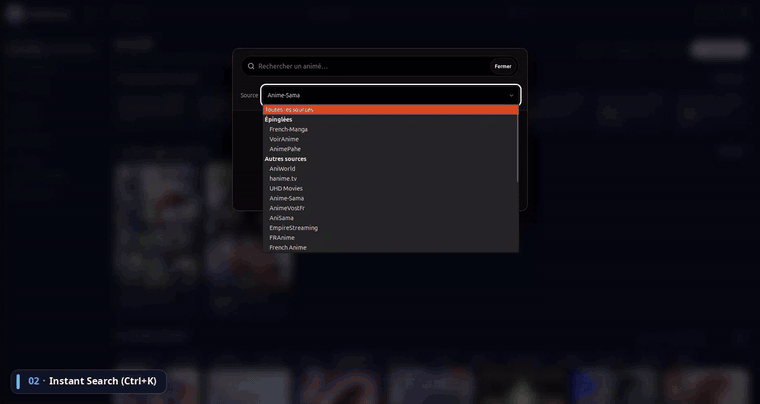

#### 2. Themes, Diagnostics, Proxies, Aniyomi & Seanime Extensions & Light Mode
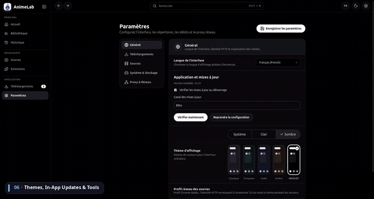

</details>

---

## Downloads & In-App Updates

Download packages from **[GitHub Releases (`v0.2.0`)](https://github.com/loeuf237/animelab/releases/latest)** ([v0.2.0 release notes](docs/releases/v0.2.0.md)). All desktop, Android, and checksum assets (`SHA256SUMS.txt`) are published together in the same release.

| Platform | Package (`v0.2.0`) | Getting started |
| --- | --- | --- |
| **Windows** x64 | `AnimeLab-v0.2.0-Windows-x64.zip` | Extract the entire ZIP archive and run `AnimeLab.exe`. |
| **Linux** x64 | `AnimeLab-v0.2.0-Linux-x64.tar.gz` | Extract the archive and run `./AnimeLab` (requires glibc 2.35+, e.g. Ubuntu 22.04+). |
| **macOS** Apple Silicon / Intel | `AnimeLab-v0.2.0-macOS-arm64-UNTESTED.zip`<br>`AnimeLab-v0.2.0-macOS-x64-UNTESTED.zip` | Choose your CPU architecture and open `AnimeLab.app`. **UNTESTED on real Apple hardware; unsigned and not notarized.** |
| **Android** 10+ ARM64 | `AnimeLab-v0.2.0-Android-arm64.apk` | Signed self-contained APK (embedded Python engine + Vue UI); no desktop server required. |
| **Browser / Docker / PWA** | Self-hosted server | Start `python run.py` or `docker compose up -d --build --wait` and open `http://localhost:8080/app/`. |

### Platform & Update Details

- **Desktop bundles:** include Python, compiled Vue frontend, `curl_cffi`, `yt-dlp`, FFmpeg, and ffprobe. Windows uses Edge WebView2; Linux uses GTK/WebKit, with automatic fallback to your installed browser if a native window cannot be created. See [desktop tools and recovery](docs/desktop-distribution.md).
- **Android standalone app:** includes its Python 3.13 / Chaquopy engine and interface offline. Completed videos are exported to shared storage (`Downloads/AnimeLab` or user-picked SAF folder) and failed exports can be retried without re-downloading. See [Android distribution and storage](docs/android-distribution.md).
- **In-app updates (`v0.2.0`):** AnimeLab checks releases at startup (if enabled) or on demand under **Settings → General**, supports stable and beta release channels, verifies downloaded files against `SHA256SUMS.txt`, hands off signed APK upgrades to Android's `PackageInstaller`, and downloads/extracts desktop update archives automatically.
- **PWA support:** in supporting desktop or mobile browsers, install the web interface via **Install** / **Add to Home Screen** (the AnimeLab server must remain running).

---

## Start the Desktop Application

**If your folder contains `desktop.py`, `pyproject.toml`, and an `animelab/` directory, you have a source checkout.** Open a terminal in that folder and run:

```bash
uv run --locked --group desktop python desktop.py
```

On Linux, you can also run **`./launcher.sh`** from the repository root (`./launcher.sh --help` for status, stop, and self-test commands). It installs locked desktop dependencies and builds the frontend automatically when missing. See [Run from source](#run-from-source) for prerequisites.

The sections below apply to **downloaded release archives** (which already include Python and the built UI):

### Linux

Extract `AnimeLab-v0.2.0-Linux-x64.tar.gz`, open a terminal inside the extracted folder containing `AnimeLab`, and run:

```bash
chmod +x AnimeLab
./AnimeLab
```

### Windows

Extract `AnimeLab-v0.2.0-Windows-x64.zip` and double-click **`AnimeLab.exe`**, or run in PowerShell from the extracted folder:

```powershell
.\AnimeLab.exe
```

### Using the Launcher

1. The native tabbed **AnimeLab Desktop Launcher** opens first (`General`, `Downloads`, `Sources`, `Extensions`, `Authentication`, `Proxies`, `Backups`, `Diagnostics`).
2. Choose your UI mode (**Native window** or installed **Browser**), port, download directory, and options, then click **Launch**.
3. Use the URL shown by the launcher (if the requested port is busy, AnimeLab binds to an available port automatically).
4. Closing the configuration window keeps the running server alive; use **Stop** for graceful shutdown.
5. Reopen the launcher later via `./AnimeLab --admin` (Linux) or `.\AnimeLab.exe --admin` (Windows), or use `--launch` to start directly with your saved preferences.

---

## Main Features

- **Browse & Global Search (`Ctrl+K` / `Cmd+K`):** built-in **French-Manga**, **VoirAnime**, and **AnimePahe** sources alongside imported Aniyomi and Seanime sources, live **Latest Releases** carousels per source, genre/tag filters, and instant search across any enabled provider.
- **Built-in Video Player:** stream directly or play local downloaded files with quality switching, audio/subtitle track menus, saved resume positions, and quick **Next Episode** controls.
- **Parallel Batch Downloads & Queue:** queue individual episodes or full seasons (`VF`, `VOSTFR`, `VO`), pick hardsubbed MP4 / softsubbed MKV output profiles, drag-reorder queue priority, pause/resume anytime, cap global transfer speed, and verify file integrity.
- **Strict Edition Isolation & Duplicate Protection:** VF, VOSTFR, and VO editions keep separate identities and filenames so different versions never overwrite one another.
- **Library & Automatic Tracking (`Auto-DL`):** favorites, quick resume history cards, per-series automatic episode monitoring (`Auto-DL`), optional Plex / Jellyfin folder naming layouts, and resilient Android shared storage export.
- **Personalization, Diagnostics & Proxy Pool:** system / light / dark themes with **5 color palettes** (`Classic`, `Teal`, `Lavender`, `Amber`, `AMOLED`), instant **EN / FR** language switcher, built-in diagnostics bundle export & disk usage monitor, and automatic public HTTPS proxy pool + custom `SOCKS5` / `HTTP` routing.

---

## Sources and Extensions

AnimeLab supports multiple extension ecosystems under **Sources → Extensions**:

1. **Aniyomi / Anikku / Animiru repositories:**
   - Import one or multiple repositories concurrently; refreshing catalogues preserves installed versions and customized recipes.
   - **Desktop / Server:** extracts DEX selectors, URLs, and request constants from APKs and executes serializable `SourceRecipe` plans through a shared Python runtime (including AJAX episodes, JSON catalogues, literal player arrays, HTML extraction, and Anime-Sama's `lien:` / `epsJeton` database). Arbitrary compiled Kotlin bytecode or encrypted logic cannot be executed directly on PC — see [recipe execution and limitations](docs/extension-recipes.md).
   - **Android:** validation builds run an isolated `:extension-runtime` APK worker host with explicit trust approval; see [extension usage and validation status](docs/studies/aniyomi-anikku/UTILISATION.md).
2. **Seanime extensions (JavaScript / TypeScript):**
   - Built-in **V8 (`mini-racer`)** JavaScript/TypeScript execution engine on Desktop/Server (`seanime_runtime.py`) for browsing Seanime marketplaces, installing extensions, running local search/health tests, and streaming/downloading.
   - An initial Android offscreen `WebView` bridge exists and is actively being stabilized in [#63](https://github.com/loeuf237/animelab/issues/63).
3. **CloudStream (`.cs3`) & Host Extractors (Roadmap):**
   - `.cs3` support for PC ([#64](https://github.com/loeuf237/animelab/issues/64)) and Android ([#65](https://github.com/loeuf237/animelab/issues/65)), expanded Anikku DEX compatibility ([#61](https://github.com/loeuf237/animelab/issues/61)), and multi-hoster video extractors ([#62](https://github.com/loeuf237/animelab/issues/62)).

If a website returns anti-bot verification, AnimeLab offers controlled verification flows with cookie capture (`docs/browser-verification.md`), as well as proxy configuration in **Settings → Proxy & Network**. Next-generation Mihon/Anikku-style temporary system WebView verification on Android and embedded PC verification are tracked in [#69](https://github.com/loeuf237/animelab/issues/69) and [#70](https://github.com/loeuf237/animelab/issues/70).

---

## Shared Server and Accounts

An optional multi-user shared-server mode provides administrator-managed accounts, invitation and recovery codes, role permissions, and private per-user libraries, source sessions, and download queues. It runs from source or Docker, and can also be enabled locally from the desktop launcher's **Authentication** tab. Personal single-user mode remains the default. See [shared-server setup and security](docs/shared-server.md).

---

## Run from Source

Requirements:

- **Python 3.12 or 3.13** (both validated in CI; `.python-version` defaults to `3.13`)
- **Node.js 22 LTS (22.13+)** and **npm**
- **FFmpeg** and **ffprobe** on `PATH`
- **uv 0.13.1** ([installation guide](https://docs.astral.sh/uv/getting-started/installation/))

Clone and install the locked Python environment:

```bash
git clone https://github.com/loeuf237/animelab.git
cd animelab
uv sync --locked
```

Install frontend dependencies and compile the Vue SPA:

```bash
cd frontend
npm ci
npm run build
cd ..
```

Rebuild the frontend (`npm run build`) whenever you edit files under `frontend/`.

### Desktop Launcher from Source (Linux & Windows)

```bash
uv sync --locked --group desktop
uv run --locked --group desktop python desktop.py
```

### Web Server from Source

```bash
uv run --locked python run.py
```

Open **[http://localhost:8080/app/](http://localhost:8080/app/)**. Legacy bookmark paths (`/downloads`, `/settings`, `/anime`, `/search`, etc.) automatically redirect to the Vue SPA with query parameters preserved.

### Configuration and Environment Variables

Settings in the UI manage language, themes, downloads, sources, and proxies. For source or server deployments, environment variables override defaults:

| Variable | Purpose | Default |
| --- | --- | --- |
| `ANIMELAB_HOST` | Server bind address | `127.0.0.1` |
| `ANIMELAB_PORT` | HTTP server port | `8080` |
| `ANIMELAB_ALLOWED_HOSTS` | Accepted HTTP `Host` headers (comma-separated, no scheme/port) | `127.0.0.1,localhost` |
| `ANIMELAB_DOWNLOAD_DIR` | Default download directory | `~/Downloads/AnimeLab` |
| `ANIMELAB_RELOAD` | Auto-reload development server on code changes | `true` |
| `ANIMELAB_CHROMIUM_PATH` | Chromium-family binary for manual source verification | Automatic detection |
| `ANIMELAB_CHROMIUM_HEADLESS` | Launch verification Chromium headlessly | `false` |

> **Host security:** requests from unlisted HTTP hosts receive HTTP 400. For LAN or reverse-proxy setups, list explicit IPs or hostnames in `ANIMELAB_ALLOWED_HOSTS` (e.g. `127.0.0.1,localhost,192.168.1.50,anime.example.org`). Wildcard subdomains (`*.example.org`) are supported; avoid `*`.
>
> **Legacy compatibility:** AnimeLab was previously named **Animan**. The Python package is `animelab`, `ANIMELAB_*` variables are preferred, and legacy `ANIMAN_*` aliases remain accepted. `.animan` data directories (`~/.animan`) and the Android package ID `com.animan.app` are intentionally retained so existing libraries and APK upgrades stay seamless (`docs/legacy-identifiers.md`).

For a non-reloading local run on Linux/macOS:

```bash
ANIMELAB_HOST=127.0.0.1 ANIMELAB_RELOAD=false uv run --locked python run.py
```

---

## Docker

With Docker Engine & Compose installed:

```bash
docker compose up -d --build --wait
```

Open **[http://localhost:8080/app/](http://localhost:8080/app/)**. The container bundles the Python backend, compiled Vue UI, FFmpeg, and named persistent volumes. Stop it with `docker compose down`. See the [Docker guide](docs/docker.md) for host-mounted download paths, backups, ports, and remote access.

---

## Community & Contribute to AnimeLab

Contributions in **English or French** are warmly welcome — whether code, Android device testing, UI mockups, bug reports, source recipes, or documentation!

- **Support & Community Chat:** **[Telegram — AnimeLab Group](https://t.me/AnimeLabGroup)**
- **Release Announcements:** **[Telegram — AnimeLab Channel](https://t.me/animelabchannel)**
- **Ideas & Q&A:** **[GitHub Discussions](https://github.com/loeuf237/animelab/discussions)**
- **Maintainer Direct Contact:** [Telegram — @loeuf237](https://t.me/loeuf237) *(keep technical decisions public on GitHub)*

### Post-v0.2.0 Priority Roadmap

See **[Tracker Issue #12](https://github.com/loeuf237/animelab/issues/12)** and the **[Detailed Contribution Priorities](docs/contribution-priorities.en.md)** for full specs. High-impact focus areas right now:

- **Extensions & Extractors:** fix Anikku/Animiru DEX translation & recipe coverage ([#61](https://github.com/loeuf237/animelab/issues/61)), expand video hoster extractors ([#62](https://github.com/loeuf237/animelab/issues/62)), stabilize Seanime JS/V8 on Android ([#63](https://github.com/loeuf237/animelab/issues/63)), and build the CloudStream (`.cs3`) engine for PC ([#64](https://github.com/loeuf237/animelab/issues/64)) & Android ([#65](https://github.com/loeuf237/animelab/issues/65)).
- **Source Verification:** Mihon/Anikku-style temporary system WebView verification on Android ([#69](https://github.com/loeuf237/animelab/issues/69)) and PC verification improvements ([#70](https://github.com/loeuf237/animelab/issues/70)).
- **PC Tools Workspace:** full Subtitle Workshop ([#66](https://github.com/loeuf237/animelab/issues/66)) and PC Audio-to-Subtitle transcription with Whisper / TurboScribe ([#67](https://github.com/loeuf237/animelab/issues/67)).
- **Great `good first issue` starting points:**
  - Telegram group prompt on first launch & Settings > About link ([#71](https://github.com/loeuf237/animelab/issues/71))
  - Auto-add anime card to library on press ([#68](https://github.com/loeuf237/animelab/issues/68))
  - Player keyboard shortcuts & Picture-in-Picture ([#51](https://github.com/loeuf237/animelab/issues/51)) · Opt-in Desktop Discord Rich Presence ([#74](https://github.com/loeuf237/animelab/issues/74))
  - Plex / Jellyfin / Kodi naming templates ([#78](https://github.com/loeuf237/animelab/issues/78)) · Automated i18n audit ([#58](https://github.com/loeuf237/animelab/issues/58)) · Vite code-splitting ([#57](https://github.com/loeuf237/animelab/issues/57))
  - Linux source guide ([#21](https://github.com/loeuf237/animelab/issues/21)) · Extra theme palette ([#28](https://github.com/loeuf237/animelab/issues/28))

Read **[First contribution guide](docs/first-contribution.en.md)** and **[CONTRIBUTING.en.md](CONTRIBUTING.en.md)** ([Français](CONTRIBUTING.md)) before opening a PR.

### Local Development & CI Checks

To develop the Vue frontend with hot reload while keeping the Python API running on port `8080`:

```bash
cd frontend
npm run dev
```

Vite serves the frontend at **http://localhost:5173** and proxies `/api` requests to port `8080`.

To run the full validation suite matching [`.github/workflows/ci.yml`](.github/workflows/ci.yml) (Ruff, mypy, ESLint, Prettier, Vue/TypeScript build, Python 3.12/3.13 tests, and Playwright UI tests):

```bash
cd frontend
npx playwright install --with-deps chromium
cd ..
uv run --locked python scripts/check.py all
```

To run only the Python test suite (requires `frontend/dist` to be built):

```bash
uv run --locked python scripts/check.py python
```

Python dependencies are locked in `uv.lock` (runtime export in `requirements.txt`), and frontend dependencies in `frontend/package-lock.json`. The backend engine lives in `animelab/` and desktop packaging uses `animelab.spec` — see [package namespace notes](docs/package-namespace.md) and the [development guide](docs/development.md).

---

## Documentation Index

- **Setup & Platforms:** [First-run & updates](docs/startup-and-updates.md) · [Desktop distribution](docs/desktop-distribution.md) · [Android distribution & storage](docs/android-distribution.md) · [Docker guide](docs/docker.md) · [Shared server](docs/shared-server.md)
- **Extensions & Networking:** [Extension recipes & limits](docs/extension-recipes.md) · [Aniyomi/Anikku study & status](docs/studies/aniyomi-anikku/README.md) · [Browser verification & cookies](docs/browser-verification.md) · [Proxy provider evaluation](docs/proxy-providers.md)
- **Contributing & Architecture:** [Contribution priorities (EN)](docs/contribution-priorities.en.md) · [First contribution (EN)](docs/first-contribution.en.md) · [Development guide](docs/development.md) · [Mobile UI checks](docs/mobile-ui.md) · [Architecture UML diagrams](docs/architecture/README.md)
- **Releases & Assets:** [All release notes](docs/releases/) · [Branding assets](docs/branding/README.md) · [Legacy identifiers](docs/legacy-identifiers.md)

---

## License

AnimeLab is free software licensed under the **GNU General Public License, version 3 only** (`GPL-3.0-only`). You may use, modify, and redistribute it under those terms; redistributed modified versions must comply with GPLv3, including corresponding source requirements. The software is provided without warranty.

See [LICENSE](LICENSE), [NOTICE](NOTICE), and [Android third-party notices](android/app/src/main/assets/THIRD-PARTY-NOTICES.txt) for complete licensing terms.
