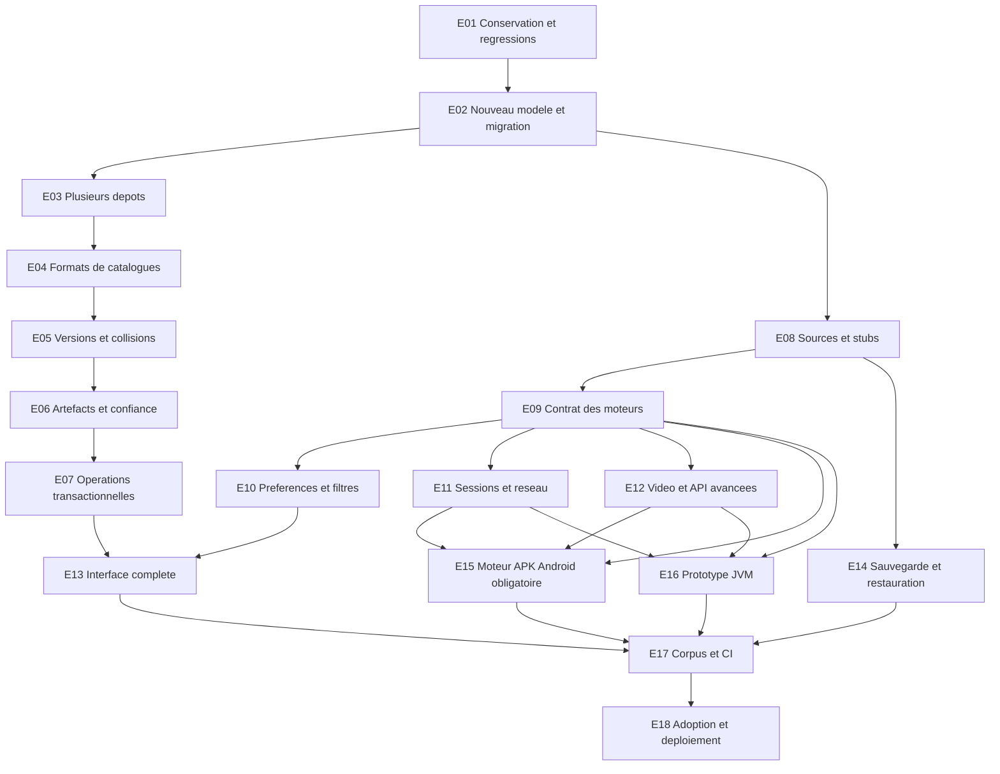

# Plan d'amélioration de la gestion des extensions AnimeLab

Plan issu du [rapport Aniyomi/Anikku du 28 octobre 2026](RAPPORT.md). **Tous les lots ci-dessous sont à implémenter.** Les scripts d'audit livrés avec l'étude ne les réalisent pas.

Les identifiants **E01–E18** sont propres à ce chantier et ne remplacent pas les phases P1–P15 des études média précédentes.

**Exigence utilisateur Android :** le gestionnaire doit installer les APK originaux comme paquets Android et charger directement les extensions partagées déjà installées par Aniyomi ou Anikku. Le [contrat APK Android](EXIGENCES_ANDROID_APK.md) définit les parcours APK01–APK14 et prime sur toute formulation antérieure présentant le moteur Android comme une option finale.

## 1. Objectif de livraison

Permettre de gérer plusieurs dépôts, conserver et mettre à jour des installations authentifiées, exposer toutes leurs sources et leurs préférences, puis étendre la compatibilité via des moteurs d'exécution mesurés. Préserver les bibliothèques, téléchargements et recettes existants durant la migration.

Sur Android, le résultat comprend obligatoirement l'installation système des APK et l'exécution de leur code, avec réutilisation des packages installés par les deux autres hôtes. L'amélioration des seules recettes constitue une étape intermédiaire.

Une lecture réussie du catalogue ne sera plus présentée comme une installation ; une installation ne sera plus présentée comme une preuve que toutes les opérations de la source fonctionnent.

## 2. Invariants obligatoires

1. Actualiser un catalogue ne change jamais l'artefact ou la recette réellement installée.
2. Le retrait d'une offre ne supprime ni l'installation ni ses références ou son historique.
3. L'ajout ou la désactivation d'un dépôt ne désactive pas implicitement les installations d'un autre dépôt.
4. Package, signataire, versionCode et API sont vérifiés contre l'artefact avant activation.
5. Une nouvelle identité cryptographique ne remplace pas silencieusement une identité approuvée.
6. Une source a une identité distincte du package et de son libellé affiché.
7. Les IDs 64 bits traversent l'API et Vue sans perte de précision.
8. Une mise à jour publie un état cohérent ou conserve la version précédente utilisable.
9. Les opérations longues ont un identifiant, une échéance, une progression et une annulation.
10. Sessions, secrets et bibliothèques restent isolés par compte.
11. Une erreur de catalogue, un défi ou une incompatibilité ne devient pas un succès vide.
12. Un runtime de code n'est pas activé en production avant sa validation de compatibilité et de sécurité sur la plateforme concernée.
13. Sur Android, « installé comme APK » correspond à un package réellement installé et vérifié auprès du système, pas à une recette compilée.
14. Les APK partagés restent inchangés et réutilisables entre hôtes compatibles ; une installation privée d'un autre hôte nécessite un export ou un téléchargement explicite.

## 3. Enchaînement proposé

Ce schéma exprime les dépendances, pas une demande de lancer des agents ou des travaux en parallèle. Certaines fonctionnalités de gestion peuvent être livrées avant les moteurs si leurs invariants sont validés.

## 4. Lots de réalisation

### E01 — Corriger les pertes lors des rafraîchissements

**Priorité : critique.** Dépendances : aucune.

Périmètre : `extension_service.py`, réconciliation d'index et tests des mises à jour.

- Retirer la suppression des installations absentes d'un catalogue valide ; enregistrer l'absence comme un état de publication.
- Ne plus invalider la recette installée lors d'une simple actualisation de métadonnées distantes.
- Faire converger import, refresh et check-updates vers les mêmes règles de conservation.
- Préserver le dernier catalogue sain lors des réponses incomplètes, invalides ou indisponibles.

**Acceptation :** A02 et A05 sont remplacés par des tests prouvant la conservation de la ligne, de la recette, de son historique, de sa version et de la source active. Tester disparition/réapparition, catalogue vide valide, erreur HTTP et interruption au milieu de l'actualisation. Ne pas qualifier un catalogue vide de panne par défaut.

### E02 — Séparer le domaine et migrer les données

**Priorité : critique.** Dépendances : E01.

Créer des entités distinctes pour dépôts, snapshots, offres, artefacts, installations, sources, alias, confiance, paramètres et opérations. Une installation référence le hash d'un artefact ; une offre référence sa provenance. Les résultats de compilation sont versionnés séparément de la version du paquet.

Documenter les correspondances des colonnes actuelles. Garder les identifiants historiques-package comme alias. Ne pas supprimer les anciennes tables avant validation des comptes et de leurs sauvegardes.

**Acceptation :** migration idempotente d'une base neuve et de bases aux versions précédentes ; égalité des favoris, progression, chemins téléchargés, recettes et révisions avant/après ; rollback documenté. Toute ambiguïté de source multiple est signalée, jamais résolue silencieusement.

### E03 — Gérer plusieurs dépôts indépendants

**Priorité : élevée.** Dépendances : E02.

Ajouter liste, ajout, édition contrôlée, activation/désactivation de publication, rafraîchissement individuel et suppression d'un dépôt. Conserver les installations indépendamment de sa visibilité et rendre la provenance consultable.

Canonicaliser les URL sans changer leur sémantique. Prévoir migration d'adresse et détection de doublons. Ne pas imposer universellement l'unicité d'une empreinte : plusieurs miroirs peuvent partager un signataire ; distinguer miroir approuvé et dépôt distinct.

**Acceptation :** deux dépôts actifs, un dépôt en panne, un miroir, désactivation et retrait de chacun ; A01 devient un test de coexistence. Aucun ajout ne fait disparaître les sources précédentes.

### E04 — Prendre en charge les catalogues historiques et modernes

**Priorité : élevée.** Dépendances : E03.

Implémenter les parseurs typés `index.min.json` + `repo.json`, store JSON, store Protobuf, gzip, `index_v2`, liste intégrée et liste externe. Conserver contacts, badge, avertissements de contenu, langues, miroir et messages des sources.

Appliquer les validations d'URL aux références indirectes et aux redirections. Ajouter des plafonds de taille, décompression, nombre d'éléments et profondeur de migration. Conserver les erreurs par dépôt et la dernière réponse saine. Un cache conditionnel HTTP peut réduire les transferts lorsqu'un serveur l'autorise ; ce mécanisme est une amélioration proposée, pas une propriété supposée des catalogues.

**Acceptation :** même résultat normalisé pour les représentations équivalentes ; refus d'une boucle `index_v2`, d'une référence privée non autorisée, d'une archive gzip excessive et d'un schéma invalide ; contenu inconnu géré sans exécution. Tester BOM, espaces et champs facultatifs.

### E05 — Versions numériques et conflits de provenance

**Priorité : élevée.** Dépendances : E04.

Persister `versionCode`, `versionName`, API et signataire comme champs séparés. Ordonnancer les versions par code numérique. Afficher plusieurs candidats pour un package en conflit, puis respecter le dépôt/signataire choisi. La vérification du manifeste reste requise à l'installation.

**Acceptation :** A04 devient un refus de downgrade ; versions de nom identique avec codes différents, nom différent avec même code, candidat API non supportée, deux signataires et deux dépôts proposant le même package. Aucun candidat incompatible n'est proposé comme mise à jour automatique sûre.

### E06 — Vérifier les artefacts et gérer la confiance

**Priorité : critique avant tout moteur de code.** Dépendances : E05.

Choisir et documenter un vérificateur de signatures APK. Inspecter manifeste binaire, fonctionnalité anime, package, API, versionCode et entrées de source. Vérifier signatures et lignées, calculer le SHA-256 du contenu et garder la provenance.

Séparer confiance dans un dépôt, épinglage d'identité et approbation d'une version. Définir rotation, révocation et retrait d'un dépôt. Éviter les exceptions de confiance des builds de développement dans les builds distribués. Borner également le ZIP, le DEX et le coût du parseur même pour une signature valide.

**Acceptation :** A06 n'est plus admis comme extension authentifiée ; corruption, package substitué, mauvais code, signature v1/v2/v3 selon le support annoncé, multi-signature, rotation autorisée et non autorisée. Aucun schéma non vérifié n'obtient un badge de confiance par défaut.

### E07 — Opérations d'installation transactionnelles

**Priorité : élevée.** Dépendances : E06.

Créer un service d'opérations persistantes : préparer, télécharger, vérifier, compiler/charger, valider, publier, nettoyer. Limiter concurrence et disque ; sérialiser les mutations d'une installation ; permettre annulation et reprise explicite.

Conserver une version précédente vérifiée pour un retour arrière contrôlé. Pour les paquets Android partagés, respecter les restrictions système sur les downgrades et ne pas promettre un retour arrière automatique refusé par Android. Traiter les mises à jour en lot comme plusieurs opérations avec bilan individuel. Ne pas déclarer tout le lot réussi lorsqu'une partie échoue.

**Acceptation :** tests de coupure à chaque frontière ; annulation pendant téléchargement, vérification et chargement ; lancement simultané de deux mises à jour ; échec d'espace disque ; retour arrière ; aucun artefact partiel activé ni ancienne version détruite prématurément.

### E08 — Sources multiples, identités, stubs et aliases

**Priorité : élevée.** Dépendances : E02 ; enrichissement après E06.

Créer toutes les sources déclarées puis confirmer celles effectivement exposées par le moteur. Garder package et source séparés. Stocker et transmettre les IDs numériques amont sans perte de précision ; conserver les aliases package existants.

Ajouter activation, masquage et préférences par source. Garder les stubs des sources indisponibles. Détecter les conflits d'ID et les correspondances ambiguës sans fusionner des bibliothèques.

**Acceptation :** A03 devient deux sources distinctes ; plusieurs langues dans un APK, ID supérieur à `2^53`, source renommée, extension retirée, réinstallation et migration choisie. Références, favoris et téléchargements restent attribués au bon fournisseur.

### E09 — Contrat commun et niveaux de compatibilité

**Priorité : élevée.** Dépendances : E08.

Définir une interface commune pour recettes Python et futurs moteurs : inventaire, capacités, préférences, recherche/catalogue, détails, épisodes/saisons, hébergeurs et vidéos. Définir erreurs typées, annulation, version du protocole IPC, limites de messages et délais.

Attribuer à chaque opération un niveau : déclarée, implémentée, testée sur fixture, vérifiée sur site, indisponible ou incompatible. La santé courante reste distincte de la capacité.

**Acceptation :** les recettes existantes passent via un adaptateur sans perte de leurs diagnostics ou protections. Un moteur partiel ne se déclare pas compatible avec toutes les API. Un changement de moteur est explicite et traçable.

### E10 — Filtres et préférences typés

**Priorité : élevée.** Dépendances : E09.

Représenter tous les types de filtres observés, leur ordre, leur état et les options de tri. Créer un schéma de préférences compatible avec Vue et un pont vers les contrôles Android pris en charge. Séparer réglages de source, réglages de navigation et secrets.

**Acceptation :** groupe imbriqué, tri ascendant/descendant, tri nul, tri-state, liste, texte, reset et préférences persistantes de deux sources d'un même APK. Afficher un contrôle non pris en charge plutôt que l'ignorer. Aucun secret dans les recettes, exports ordinaires ou diagnostics.

### E11 — Contrat réseau, sessions et isolation

**Priorité : critique avant moteur de code.** Dépendances : E09.

Définir le contexte réseau par compte/source, les cookies par domaine, les changements de proxy/miroir, l'authentification, les défis et les budgets. Ajouter un broker si le runtime l'exige et vérifier que le code ne peut pas simplement le contourner.

Les validations doivent couvrir accès fichiers, sockets directes, loopback, DNS/rebinding, redirections, sous-processus, volume de réponse, temps CPU et mémoire. Les contrôles dépendent de l'OS ; une limite de processus ou un IPC n'est pas une preuve de bac à sable.

**Acceptation :** extension de test tentant chaque accès interdit, deux comptes sur un même domaine, défi annulé, cookies nettoyés avec portée affichée, fermeture du runtime pendant un appel. Tests sans credentials réels. Toute protection non démontrée est consignée comme limite.

### E12 — Contrats vidéo et API avancées

**Priorité : élevée pour parité ; capacités avancées activées après preuve.** Dépendances : E09.

Mapper hébergeurs, résolution différée, ordre/préférence, vidéos, en-têtes, pistes audio/sous-titres, chapitres, mémos et données internes. Implémenter les appels combinés de l'API 17, saisons et relations.

Traiter séparément serveur HTTP de source, miniatures et torrent. Les arguments mpv/FFmpeg sont convertis via une politique d'options autorisées ; ils ne deviennent pas des commandes arbitraires.

**Acceptation :** deux hébergeurs dont un en échec, URL expirée, résolution annulée, pistes avec en-têtes, saison/épisodes sans écrasement partiel, mémo transmis sans perte. Pour HTTP local, seule une instance possédée et autorisée est joignable. Pour torrent, admission, stockage et arrêt sont prouvés avant activation.

### E13 — Interface complète de gestion et diagnostics

**Priorité : élevée.** Dépendances : E03, E07, E08, E10.

Présenter dépôts et états de récupération ; extensions installées, disponibles, retirées, non approuvées ou incompatibles ; détails des sources et de leurs capacités. Afficher versions installée/disponible, signataire, provenance et moteur.

Ajouter actions indépendantes de nettoyage de cache, cookies, préférences, désactivation et désinstallation. Conserver recherche et langues ; compléter épinglage, dernière source et variantes régionales. Prévoir confirmation uniquement pour les effets destructifs réels.

**Acceptation :** parcours mobile et bureau avec plusieurs dépôts, sources multiples et mise à jour en lot partiellement échouée. Un utilisateur comprend pourquoi une extension installée n'est pas exécutable et quelle donnée sera effacée avant une suppression.

### E14 — Sauvegarde, restauration et migration de bibliothèque

**Priorité : élevée.** Dépendances : E08 et modèle de confiance E06.

Étendre la sauvegarde aux identités, mappings, recettes, versions, provenance et paramètres non secrets. Définir une option distincte pour les artefacts hors ligne et une protection adaptée pour les sessions si leur sauvegarde est proposée.

Restaurer les stubs même si les dépôts sont indisponibles. Revérifier le code avant exécution ; ne pas transformer un certificat mentionné par une sauvegarde en confiance automatique illimitée.

**Acceptation :** restauration hors ligne des métadonnées et, si demandée, des artefacts ; restauration avec clé différente, dépôt retiré, deux anciennes sources fusionnables mais ambiguës, et bibliothèque contenant déjà des téléchargements. Aucune perte silencieuse.

### E15 — Moteur Android et interopérabilité des APK partagés

**Priorité : obligatoire pour achever le périmètre Android.** Dépendances : E06, E09, E11, E12. La première étape reste un prototype de faisabilité, suivi de l'implémentation complète et des essais de réception.

Installer les APK originaux via `PackageInstaller`, suivre l'autorisation et le résultat système, puis découvrir les paquets d'extensions déjà présents, quelle que soit l'application les ayant installés. Ne pas limiter la visibilité aux seuls packages d'Aniyomi et d'Anikku : leurs extensions ont des packages distincts.

Implémenter le chargement réel d'extensions dans un composant dédié. Documenter les API de l'union 12–17 ciblée, bibliothèques de l'hôte, classloaders, modèle des préférences, ressources, callbacks réseau et cycle de vie. Préserver package, signature, version et octets de l'APK ; aucun portage en recette n'est requis pour ce parcours.

Comparer une stratégie à UID identique et, si faisable, une stratégie de service isolé avec échange d'artefacts/IPC. Un service isolé Android n'hérite pas simplement des permissions et accès de l'application : démontrer le chargement de code, le stockage et les requêtes nécessaires avant de le choisir.

**Acceptation :** les tests APK01–APK14 du [contrat Android](EXIGENCES_ANDROID_APK.md) passent, dont installation via chaque hôte puis chargement depuis AnimeLab, parcours réciproque vers les hôtes compatibles, mono-source, fabrique multi-source, préférences, JavaScript, hébergeurs et API annoncées ; arrêt/reprise et rechargement sans fuite d'anciennes classes. Les essais passent sur les versions Android représentatives, un émulateur et un appareil ARM64 supporté, avec un build optimisé. Builds et APK via GitHub Actions, conformément à notre circuit de distribution.

**Condition de sortie :** exécution réelle et interopérabilité démontrées, avec preuves, limites de permissions et coûts mémoire/démarrage. Une non-adoption de la première approche conduit à chercher une autre réalisation ou à demander une décision de périmètre ; elle ne remplit pas l'objectif Android. Un contrôle échoué interdit de déclarer ce lot terminé ou d'activer le moteur dans une release.

### E16 — Prototype de moteur JVM pour bureau

**Priorité : recherche structurante.** Dépendances : E06, E09, E11, E12.

Évaluer un runtime externe JVM, les bibliothèques hôtes et les stubs Android nécessaires. Comparer un JAR compatible publié à la conversion d'un APK DEX lorsque c'est possible. Une conversion réussie n'est pas le critère final : exécuter les opérations des sources du corpus.

Documenter les dépendances natives, les contrôles Linux/Windows/macOS, le packaging JRE, les mises à jour et la frontière de permissions. Toute solution existante supplémentaire envisagée devra faire l'objet d'un audit séparé avant adoption ; cette étude n'en valide aucune.

**Acceptation :** résultats comparables au corpus de référence pour les API annoncées, annulation et redémarrage, code de test hostile, fonctionnement sans JDK utilisateur si le runtime est distribué, absence de collision avec le serveur Python. Validation spécifique Linux et Windows ; macOS reste explicitement non validé tant qu'il n'est pas testé.

**Condition de sortie :** décision de compatibilité et de sécurité par plateforme. Possibilité de conserver le moteur expérimental désactivé si les exigences ne sont pas atteintes.

### E17 — Corpus, tests et CI reproductibles

**Priorité : obligatoire pour chaque livraison.** Dépendances : lots concernés, puis E15/E16 pour leurs validations finales.

Créer des APK synthétiques contrôlés, mono/multi-sources, signés avec des clés de test sans usage personnel. Enregistrer leurs hashes et contrats attendus. Couvrir les API et signatures annoncées ; utiliser des serveurs de fixtures pour les appels et médias.

L'exécution d'extensions communautaires dans la CI générale n'est pas une dépendance acceptable aux sites externes. Prévoir une campagne optionnelle séparée pour les essais autorisés de compatibilité réelle, avec provenance, version et date.

**Acceptation :** matrice de contrats sur chaque moteur, migrations et coupures, sauvegardes, scénarios réseau, plafonds, tests d'interface et artifacts de preuve. Les chemins non pris en charge échouent explicitement. Les tests des protections utilisent des secrets factices et n'ouvrent pas les comptes de production.

### E18 — Adoption, déploiement et suivi

**Priorité : dernière condition de distribution.** Dépendances : E17.

Publier un dossier de décision : capacités prouvées, corpus et résultats, limites de sécurité, dépendances et notices, taille, démarrage, mémoire, récupération d'erreur et stratégie de rollback. Définir le choix du moteur et les migrations activées par version.

La nouvelle gestion avec le moteur de recettes conservé peut être livrée comme étape intermédiaire. L'achèvement Android exige E15 et ses tests APK ; une étape limitée aux recettes ne remplit pas cet objectif final. Activer chaque moteur selon ses preuves, sans reprendre une promesse de compatibilité d'une autre plateforme. Documenter les incompatibilités et les étapes de retour à la version précédente.

**Acceptation :** CI verte du commit livré, migration et restauration démontrées, documentation utilisateur cohérente, aucun moteur expérimental activé implicitement. Les logs et diagnostics ne contiennent pas cookies, tokens, credentials ou données privées de bibliothèque.

## 5. Matrice des découvertes à couvrir

Le tableau relie chaque découverte à un lot. Les références `AY-*`, `AK-*` et `LIB-*` figurent dans [SOURCES.md](SOURCES.md). Les A01–A06 sont reproduits dans les cas d'audit.

| ID | Découverte / écart | Preuve principale | Lots |
| --- | --- | --- | --- |
| D01 | Dépôts coexistants et récupération indépendante. | AY-REPOS, AK-UPDATE ; A01 | E02, E03 |
| D02 | Dépôt désactivé sans suppression. | AK-PREFS | E03, E13 |
| D03 | Métadonnées `repo.json` et identité du mainteneur. | AK-REPO, AK-CREATE | E04, E06 |
| D04 | Store JSON/Protobuf et gzip. | AY-STORE, LIB-INDEX | E04 |
| D05 | `index_v2`, liste externe, URL et miroirs. | AY-STORE, AY-INDEX | E04, E11 |
| D06 | Doublons et changement d'adresse. | AK-CREATE, AK-SCHEMA | E03, E05 |
| D07 | Épinglage/rotation de clé différents entre les deux apps. | AK-REPO-UPDATE, AY-REPOS | E06 |
| D08 | Candidats de même package et signataires différents. | AK-MANAGER, AY-MANAGER | E05, E13 |
| D09 | Offre disponible distincte de la version installée. | Managers ; A05 | E01, E02 |
| D10 | Extension retirée conservée et réapparition. | Managers ; A02 | E01, E08 |
| D11 | VersionCode distinct du nom de version et de l'API. | AY-UPDATE, AK-UPDATE ; A04 | E05 |
| D12 | Vérification des mises à jour distincte de leur installation. | AY-UPDATE, AY-UI | E05, E07, E13 |
| D13 | Manifeste et classes d'entrée requis. | AY-LOADER ; A06 | E06 |
| D14 | API Aniyomi 14/16/17, API Anikku 12–16. | Loaders | E06, E09, E17 |
| D15 | Signatures et historique/multi-signataires. | Loaders | E06 |
| D16 | Confiance de dépôt et approbation de version. | AY-TRUST, AK-TRUST | E06, E13 |
| D17 | Privé/partagé et choix de version. | Loaders | E07, E15 |
| D18 | Installateurs legacy, système, Shizuku, privé. | AY-MODES, AY-INSTALL | E07, E15 |
| D19 | États, file d'installation et annulation. | AY-QUEUE, AY-INSTALL | E07 |
| D20 | Publication atomique et reprise à renforcer. | AY-LOADER ; analyse locale | E01, E07 |
| D21 | Fabriques et toutes les sources d'un APK. | AY-LOADER ; A03 | E08, E15, E16 |
| D22 | IDs stables de source distincts du package. | AY-HTTP, AY-SOURCES | E02, E08 |
| D23 | Stubs, bibliothèque et migration des références. | AY-SOURCES, AY-BACKUP-SOURCE | E08, E14 |
| D24 | Catalogue/recherche/détails/épisodes par méthodes surchargées. | AY-HTTP, AY-SOURCE-API | E09 |
| D25 | Filtres structurés et tri-state. | AY-FILTER | E10 |
| D26 | Préférences de chaque source et callbacks d'interface. | AY-PREFS-API, AY-PREFS-UI | E10, E15, E16 |
| D27 | Langues, masquage, épinglage, dernière source et incognito. | AY-SOURCE-PREFS, AK-PREFS | E10, E13 |
| D28 | Client réseau, cookies, cache et défis. | AY-NETWORK | E11 |
| D29 | Évaluation JavaScript réelle. | AY-JS | E09, E15, E16 |
| D30 | Classloader et code exécuté, absence de frontière de privilèges démontrée. | AY-CLASSLOADER | E11, E15, E16 |
| D31 | Hébergeurs, vidéos différées et repli. | AY-HOSTER, AY-HTTP | E12 |
| D32 | En-têtes, pistes audio/sous-titres et chapitres. | AY-VIDEO, AK-VIDEO | E12 |
| D33 | Données internes/mémos et options de lecteurs. | AY-VIDEO | E12 |
| D34 | Serveur HTTP possédé par la source. | AY-HTTP-SERVER, AY-VIDEO | E11, E12 |
| D35 | Torrent et miniatures : capacités séparées. | AY-HTTP, LIB-INDEX | E12, E17 |
| D36 | API 17 : détails/épisodes/saisons combinés et relations. | AY-SOURCE-API | E09, E12 |
| D37 | Nettoyage ciblé des cookies et diagnostic. | AY-DETAILS, code local | E11, E13 |
| D38 | Sauvegardes des dépôts, préférences et identités. | AY-BACKUP, AY-BACKUP-SOURCE | E14 |
| D39 | Import via liens applicatifs. | AY-MANIFEST | E03, E13 |
| D40 | Corpus de compatibilité et adoption par plateforme. | Synthèse des limites établies | E17, E18 |

Pour D39, un lien doit préremplir et faire valider l'ajout ; il ne doit jamais installer ni approuver silencieusement une extension. Les paramètres, encodages et URL indirectes restent soumis aux validations réseau.

## 6. Contrat de livraison par étape

Chaque lot livré doit contenir les migrations et comportements finaux, les tests correspondant aux invariants, une documentation des limites et une mise à jour de cette matrice. Le changement doit être testé avec le frontend compilé lorsque les parcours en dépendent.

Les réalisations Android et JVM sont distinctes. Un prototype non adopté doit être rapporté comme tel ; il ne termine pas l'exigence Android d'interopérabilité APK. Les recettes connues doivent continuer à fonctionner durant ces évaluations, avec un moteur explicite.

Les mises à jour de l'application, les APK Android et les vérifications de distribution restent dans les workflows GitHub Actions. Aucune étape de ce plan ne demande de compiler ou publier localement un APK de release.
