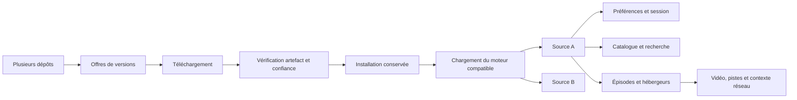
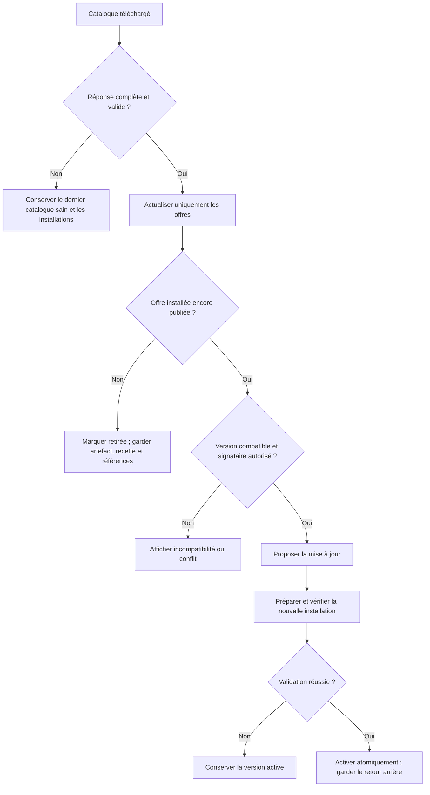

# Gestion complète des extensions : Aniyomi, Anikku et AnimeLab

Étude arrêtée au **28 octobre 2026**. Références exactes et méthode dans le [dossier de l'étude](README.md). Les identifiants de sources employés ci-dessous renvoient à des fichiers amont figés ; le [registre](SOURCES.md) et le [manifest JSON](sources.json) permettent de les retrouver.

**Précision utilisateur après l'étude :** l'installation réelle des APK et leur réutilisation entre AnimeLab Android, Aniyomi et Anikku sont un résultat obligatoire. Le [contrat Android APK](EXIGENCES_ANDROID_APK.md) fixe cette exigence, ses limites de stockage privé et les preuves requises. Les propositions ci-dessous se lisent avec cette condition supplémentaire.

## 1. Synthèse des décisions proposées

1. Remplacer le modèle « dernier dépôt ajouté = seul dépôt actif » par plusieurs dépôts indépendants.
2. Séparer les offres des catalogues, les versions effectivement installées et les instances de sources.
3. Conserver les installations et leur historique lorsqu'un paquet disparaît du catalogue ; présenter un état « retiré du dépôt ».
4. Traiter le code de version, l'API d'extension et le nom de version comme trois informations distinctes.
5. Vérifier l'identité réelle du paquet et ses signatures ; une archive ZIP contenant un DEX n'est pas une extension authentifiée.
6. Enregistrer toutes les sources d'un APK, avec leurs identifiants amont, leurs langues et leurs préférences.
7. Définir un contrat de source commun pour les recettes existantes et les futurs moteurs d'exécution.
8. Réaliser et valider le moteur APK Android obligatoire et évaluer séparément une solution JVM de bureau. Ne pas annoncer une compatibilité APK complète avant ces preuves.
9. Conserver les protections et les fonctions déjà utiles d'AnimeLab : transport réseau contrôlé, historique des recettes, restauration, diagnostics et transactions de mise à jour.

La priorité immédiate porte sur la conservation des installations et leur identité. Le passage à un moteur de code doit ensuite apporter une compatibilité mesurable, sans rendre les données personnelles ou le serveur accessibles aux extensions.

## 2. Méthode et niveau de preuve

### 2.1 Périmètre

L'audit couvre les catalogues, métadonnées, dépôts, signatures, chargement des APK, installation, mise à jour, désinstallation, sources multiples, API, filtres, préférences, réseau, résolution vidéo, sauvegarde, migrations et présentation des erreurs.

Il concerne principalement les **extensions anime**. Aniyomi conserve des branches manga séparées ; leur existence n'implique pas que leurs contrats de pages/images soient ceux des sources vidéo. Anikku est étudié dans son périmètre anime.

La lecture porte sur 86 fichiers amont sélectionnés, les modules AnimeLab concernés et les tests locaux. Cinq fichiers centraux d'Anikku ont aussi été confrontés à `v0.2.0` : loader, manager, API de catalogue, service de métadonnées du dépôt et confiance. Ils sont identiques aux fichiers étudiés après normalisation des fins de ligne. Cette vérification ne vaut pas comparaison intégrale des deux versions.

### 2.2 Ce que signifient les constats

| Niveau | Signification |
| --- | --- |
| Code amont | Comportement visible dans la référence source citée. Il n'a pas été exécuté sur appareil pour cette étude. |
| Code local | Comportement observé dans le checkout AnimeLab étudié. |
| Reproduction locale | Cas synthétique exécuté avec une base temporaire et des réponses réseau simulées. |
| Proposition | Architecture, garde-fou ou comportement recommandé pour notre implémentation future. |
| À valider | Point nécessitant une expérience d'exécution, de plateforme ou de compatibilité. |

L'étude ne mesure pas un taux de compatibilité réel des dépôts communautaires, ne certifie pas leurs APK et ne démontre pas la sécurité d'un futur moteur. Elle ne confond pas un succès sur réponses synthétiques avec le fonctionnement d'un site externe.

### 2.3 Sources et distribution du contenu

Les projets ont annoncé en 2024 le retrait de leur liste d'extensions et un fonctionnement où l'utilisateur apporte ses sources. Il faut donc séparer l'application, le format d'extension et les dépôts communautaires. Les APK et sites sont maintenus indépendamment de l'hôte. Cela justifie chez nous l'affichage du dépôt d'origine, de son mainteneur et de ses erreurs, plutôt qu'une promesse globale de disponibilité. Sources : [annonce Aniyomi](https://aniyomi.org/news/2024-07-05-extensions-removal), [annonce Anikku](https://anikku-app.github.io/news/2024-07-05-extensions-removal).

## 3. Le modèle mental à reprendre

| Objet | Rôle | Identité utile |
| --- | --- | --- |
| Dépôt / store | Publie les métadonnées et les offres d'extensions. | URL canonique, identité du mainteneur, empreinte de signature approuvée. |
| Offre | Version annoncée par un dépôt, avec ses ressources. | Dépôt + package + versionCode + signataire annoncé. |
| Artefact | Fichier effectivement téléchargé et vérifié. | SHA-256 des octets, package réel, signatures vérifiées. |
| Installation | Version choisie et conservée par l'utilisateur. | Package + lignée de signature + emplacement/moteur. |
| Extension | Code chargeable exposant une ou plusieurs sources. | Package, API, versionCode, classe ou fabrique. |
| Source | Fournisseur concret de catalogue, détails, épisodes et vidéos. | Identifiant numérique amont et lien vers son extension. |
| Session / préférences | État utilisateur d'une source et du réseau. | Compte + source, avec portée réseau explicitement définie. |

Les relations ne sont pas « une ligne du catalogue = une source ». Une extension peut fabriquer plusieurs sources ; une source peut rester référencée dans une bibliothèque alors que son extension est absente. [AY-LOADER], [AY-SOURCES], [AK-MANAGER].

Ce diagramme synthétise le cycle ; le stockage séparé des offres et artefacts est la cible proposée pour AnimeLab, pas le schéma SQL exact des deux applications.

## 4. Ce que contient réellement une extension

### 4.1 APK, classes et contrat

Les loaders reconnaissent une extension anime par la fonctionnalité Android `tachiyomi.animeextension`. Ils lisent les métadonnées du manifeste, le nom du package, les codes de version, les signatures et les classes d'entrée. `tachiyomi.animeextension.class` peut contenir plusieurs noms séparés par un point-virgule. Un nom commençant par un point est résolu relativement au package. L'objet construit doit être une source ou une `AnimeSourceFactory`, laquelle produit une liste de sources. [AY-LOADER], [AK-LOADER].

Aniyomi accepte notamment les nouvelles métadonnées `aniyomix.name`, `aniyomix.extensionLib`, `aniyomix.contentWarning` et `aniyomix.torrent`, avec des replis vers les conventions historiques. Les indicateurs README/changelog et de fabrique font aussi partie des métadonnées lues. Les reproduire suppose d'inspecter le manifeste binaire, pas seulement les chaînes des fichiers DEX. [AY-LOADER].

### 4.2 Chargement effectif

Les classes sont chargées depuis l'APK via un `ChildFirstPathClassLoader`, puis instanciées par réflexion. Le chargeur essaie les classes système, celles de l'extension puis celles du parent. Aniyomi comporte aussi un repli vers `PathClassLoader` lors de certaines erreurs de liaison. Ce mécanisme permet au code Kotlin/Java compilé et à ses dépendances compatibles de fonctionner réellement. [AY-LOADER], [AY-CLASSLOADER].

Cela n'est pas une conversion automatique en règles de scraping. Les appels réseau, conditions, calculs, fabriques et préférences restent du code exécuté.

### 4.3 Bornes d'API réellement observées

| Application figée | Acceptation visible dans le loader |
| --- | --- |
| Aniyomi `v0.18.2.1` | Liste explicite : **14.0, 16.0, 17.0**. |
| Anikku étudié | Intervalle **12 à 16 inclus**, selon les bornes du loader. |
| AnimeLab | Pas de chargement de ces ABI ; extraction d'un sous-ensemble de constantes vers `SourceRecipe`. |

Il serait incorrect d'assimiler « Aniyomi compatible » à un intervalle universel allant de 12 à 17. Aniyomi n'admet pas 15 dans sa liste actuelle ; Anikku n'admet pas 17 dans le loader étudié. L'API de catalogue Anikku filtre elle aussi les entrées selon ses bornes. [AY-LOADER], [AK-LOADER], [AK-UPDATE].

**Conséquence :** présenter une matrice par moteur et par opération, avec une raison précise d'incompatibilité. La capacité à lire un index ou un en-tête DEX ne prouve aucune compatibilité d'exécution.

## 5. Les formats de dépôts

### 5.1 Format historique

Le catalogue historique est une liste JSON, généralement servie sous `index.min.json`. Les entrées contiennent notamment `name`, `pkg`, `apk`, `lang`, `code`, `version`, `nsfw` et `sources`. Les sources déclarent `id`, `name`, `lang` et `baseUrl`. Anikku lit aussi un indicateur `torrent`. Les URL historiques des APK et icônes sont construites relativement à la racine du dépôt. [AK-UPDATE], [AY-LEGACY-EXT].

`repo.json` contient les métadonnées du dépôt : nom, nom court éventuel, site et empreinte de clé de signature. Importer uniquement la liste d'extensions perd cette identité. Anikku exige une URL HTTPS finissant par `/index.min.json`, puis récupère `repo.json`. [AK-CREATE], [AK-REPO].

### 5.2 Nouveau format de store Aniyomi

Le schéma officiel prévoit une représentation **Protobuf ou JSON**, avec **gzip facultatif**. L'index contient le nom du store, un badge, une valeur `signingKey`, les contacts et soit une liste intégrée, soit l'URL d'une liste externe. Les champs d'extensions comprennent : package, API, versionCode, versionName, ressources APK/icône, avertissement de contenu, indicateur torrent et toutes les sources. Une source peut déclarer son URL principale, des miroirs et un message. [LIB-INDEX], [LIB-README].

Le nom `signingKey` du schéma ne doit pas faire croire qu'une signature détachée de l'index a été vérifiée : dans le mécanisme de confiance étudié, la valeur est comparée aux empreintes des signataires des APK. La protection cryptographique effectivement observée concerne l'identité des paquets ; HTTPS et la confiance initiale dans le dépôt restent importants. [AY-INDEX], [AY-TRUST].

### 5.3 Détection et transitions legacy

Le service Aniyomi détecte gzip par son en-tête. Il distingue ensuite un tableau JSON historique, un objet JSON et le binaire Protobuf. Un tableau historique conduit à récupérer le `repo.json` correspondant ; un objet legacy peut contenir `index_v2`, suivi par le service. Une liste d'extensions externe est aussi téléchargée avec décompression et décodage. [AY-STORE], [AY-LEGACY].

**Pour AnimeLab :** accepter les formats historiques et modernes, borner la taille compressée et décompressée, le nombre d'entrées, les listes externes et les migrations. Détecter proprement BOM/espaces, schéma invalide et boucle de références. Chaque URL indirecte, redirection et ressource doit conserver les contrôles de notre transport. Ces bornes et ces cas d'erreur sont des exigences proposées ; ils ne sont pas tous garantis par le service amont lu.

## 6. Coexistence, identité et confiance des dépôts

### 6.1 Plusieurs dépôts

Aniyomi persiste plusieurs stores et agrège leurs listes ; un échec individuel est journalisé et ne doit pas nécessairement empêcher la récupération des autres. Anikku agrège plusieurs dépôts et permet d'en désactiver sans les supprimer via `disabledRepos`. [AY-REPOS], [AY-SCHEMA], [AK-UPDATE], [AK-PREFS].

Notre règle actuelle est différente : `import_repository()` désactive tous les autres dépôts. Le chargement et la visibilité des sources sont limités au dépôt actif. Une extension précédemment activée reste marquée comme telle dans sa ligne SQL, mais disparaît du registre exécutable lorsqu'on importe un autre dépôt. **Reproduction A01.**

### 6.2 Doublons et changements d'adresse

Anikku impose l'unicité de l'empreinte de signature du dépôt. L'ajout distingue URL déjà présente et empreinte déjà connue. Le modèle de remplacement permet de changer l'adresse d'un dépôt reconnu par son empreinte. À l'actualisation, une nouvelle empreinte différente n'est pas silencieusement acceptée, sauf cas historique de valeur non initialisée. [AK-CREATE], [AK-SCHEMA], [AK-REPO-UPDATE].

Le repository de stores Aniyomi utilise l'URL d'index comme clé et actualise la valeur de signature reçue dans son upsert. **Ne pas lui attribuer automatiquement le même verrouillage d'empreinte qu'à Anikku.** [AY-REPOS], [AY-SCHEMA].

### 6.3 Collisions entre offres

Anikku construit une clé de candidat combinant package et empreinte de signature et utilise cette empreinte dans l'association entre une installation et son offre. Aniyomi indexe ses candidats par package dans le manager lu. Ces comportements ne donnent pas la même résolution d'un package proposé par deux dépôts. [AK-MANAGER], [AY-MANAGER].

L'API de vérification de mises à jour Anikku effectue cependant sa première recherche par package ; il faut distinguer cette notification de l'action de mise à jour du manager, qui utilise aussi la signature. Il ne faut pas décrire toute la chaîne comme uniformément résolue par la même clé. [AK-UPDATE], [AK-MANAGER].

**Cible proposée :** garder toutes les offres ; afficher les collisions ; choisir une provenance approuvée ; ne jamais remplacer automatiquement un signataire par un autre parce qu'un numéro de version est supérieur.

## 7. Signature, authenticité et limites de sécurité

### 7.1 Vérifications observées

Les loaders extraient les empreintes SHA-256 des certificats. Sur les Android récents, ils distinguent les signataires multiples et l'historique de signature. Une extension sans signature ou non approuvée n'est pas traitée comme une source chargée avec succès. L'état non approuvé conserve les informations nécessaires au choix de l'utilisateur. [AY-LOADER], [AK-LOADER].

Le système reconnaît soit une empreinte d'un dépôt connu, soit une approbation manuelle portant sur **package + versionCode + empreinte**. L'approbation manuelle d'une nouvelle version remplace celle de l'ancienne. Une signature reconnue par le dépôt évite donc de demander nécessairement une confiance manuelle à chaque mise à jour. [AY-TRUST], [AK-TRUST].

La confiance par dépôt est évaluée à partir des empreintes de l'ensemble des dépôts enregistrés : ce n'est pas, dans ces fonctions, une preuve que cet APK précis a été téléchargé depuis l'URL de ce dépôt. Notre futur modèle devra conserver la provenance en plus de la confiance cryptographique.

Anikku comporte des exceptions visibles pour les builds de développement et une empreinte intégrée du projet. Ces exceptions doivent être documentées comme choix amont, et **ne pas être reprises comme contournement dans nos builds de production**. [AK-TRUST].

### 7.2 Mise à jour privée et continuité

Lorsqu'une version existe déjà, l'installateur privé vérifie notamment le code de version et la continuité des signatures avant de remplacer le fichier. Il refuse un downgrade numérique. Les APK privés sont copiés dans le stockage de l'application et rendus en lecture seule. [AY-LOADER], [AK-LOADER].

La copie amont commence par supprimer la cible existante. Cela ne constitue pas une garantie générale de remplacement transactionnel avec restauration après coupure. AnimeLab devrait conserver son principe de publication atomique et une version précédente vérifiée plutôt que reproduire ce détail. [AY-LOADER].

### 7.3 Une signature n'est pas un bac à sable

Le code est instancié dans le processus hôte par un classloader. Le code analysé ne constitue pas une frontière de privilèges entre l'extension et l'application. De même, « privée » décrit un emplacement d'installation, pas une garantie d'isolation du code. Le filtrage de langue et le masquage de contenu ne sont pas des protections d'exécution. [AY-CLASSLOADER], [AY-LOADER], [AY-SOURCE-PREFS].

Notre validation actuelle `_validate_apk()` confirme surtout la présence de DEX et leurs premiers octets. Une archive sans manifeste Android ni signature passe ce validateur dans le cas A06. Le nom du cache est un hash de package/version/URL ; ce n'est pas le hash cryptographique du fichier téléchargé. Aucun de ces éléments ne doit être affiché comme une preuve d'authenticité.

**Cible :** inspecter manifeste, identité réelle, code de version, API, signature complète, lignée autorisée et empreinte du contenu. Lire `META-INF` seul ne suffit pas pour couvrir les schémas modernes de signature APK. Le vérificateur retenu devra être testé sur des APK v1/v2/v3 et sur les erreurs de signature pertinentes ; les schémas non pris en charge devront être refusés ou explicitement signalés.

## 8. Installation, file d'attente et désinstallation

### 8.1 Modes Android

Les modes déclarés sont `LEGACY`, `PACKAGEINSTALLER`, `SHIZUKU` et `PRIVATE`. Les deux premiers utilisent l'installation Android, Shizuku dépend de son service et de ses autorisations, et le mode privé garde le fichier dans l'application sans enregistrer une application système supplémentaire. La préférence effectue des replis selon les capacités disponibles ; elle tient notamment compte de variantes MIUI et de l'installation de Shizuku. [AY-MODES], [AY-MODE-CHECK], [AY-INSTALL].

L'exigence utilisateur rend l'installation Android partagée obligatoire. Le parcours standard doit utiliser l'installateur Android et détecter les paquets déjà installés par les autres hôtes. Shizuku n'est pas nécessaire pour définir ce parcours ; le mode privé ne peut être qu'une option explicitement distincte. Les fichiers conservés dans le stockage privé d'un autre hôte ne sont pas découvrables comme paquets partagés.

### 8.2 Progression et annulation

Le téléchargement d'APK passe par Android `DownloadManager`. Le manager suit les demandes et observe les états. Une file distincte sérialise les installations nécessitant l'installateur. Les états publiés comprennent attente, téléchargement, installation, réussite et erreur ; les flux réactifs alimentent l'interface. L'annulation retire le téléchargement et agit sur la file d'installation. [AY-INSTALL], [AY-QUEUE], [AY-UI].

L'existence de `DownloadManager` ne prouve pas que l'état applicatif soit intégralement reconstruit après tout arrêt brutal : certaines cartes d'opérations sont en mémoire. Notre cible doit avoir des identifiants d'opération persistants, des délais, une annulation explicite, un redémarrage contrôlé et une publication atomique.

### 8.3 Installation partagée ou privée

Les loaders repèrent les extensions Android installées et les extensions privées. Si les deux versions d'un même package existent, la version au code supérieur est privilégiée ; à égalité, la version partagée gagne dans le choix lu. Les événements d'ajout, remplacement et suppression actualisent les registres. [AY-LOADER], [AK-LOADER], [AY-MANAGER].

Pour nous, ces emplacements doivent devenir des informations explicites. Une désinstallation doit proposer séparément le retrait du paquet, l'effacement de ses préférences, celui de ses sessions et la conservation des références de bibliothèque. Elle ne doit pas effacer automatiquement les épisodes téléchargés.

## 9. Versions, mises à jour et disparition des paquets

### 9.1 Trois versions différentes

Le **versionCode** sert à ordonner les versions ; le **versionName** est une présentation ; la **version de l'API** détermine le contrat attendu. Les managers étudiés détectent une version plus récente et/ou une API plus récente. Le format legacy déduit souvent l'API du préfixe du nom de version ; le nouveau format la transmet explicitement. [AY-UPDATE], [AK-UPDATE], [AY-INDEX].

Dans AnimeLab, la différence entre chaînes est encore employée pour marquer une mise à jour. Le cas A04 montre qu'une version distante inférieure peut ainsi être annoncée comme une mise à jour. Ne pas corriger cela par un simple tri lexicographique des chaînes : conserver le `code` du catalogue et celui du manifeste vérifié.

### 9.2 Vérification et installation sont deux opérations

La vérification récupère les métadonnées, compare les installations et publie un compteur ou une notification. L'action d'installation décide ensuite d'appliquer une version. Les API amont contiennent un cache temporel et une limite d'un jour dans certaines branches d'appel ; les conditions ne sont pas identiques entre Aniyomi et Anikku. **Ne pas en déduire une vérification systématique exactement toutes les 24 heures, ni une installation automatique universelle.** [AY-UPDATE], [AK-UPDATE], [AY-UI].

Notre `check_updates()` conserve déjà une distinction utile entre valeurs installées et disponibles. En revanche, le rafraîchissement général par `import_repository()` peut effacer `recipe_json` si des métadonnées changent. A05 reproduit cette perte pour une extension installée mais désactivée. Les deux chemins doivent converger vers une seule réconciliation conservatrice.

### 9.3 Retrait d'une offre

Les managers amont possèdent un état obsolète lorsque le package n'est plus trouvé dans les candidats ; cela ne désinstalle pas l'APK et ne supprime pas automatiquement la bibliothèque. Anikku réinitialise également cet état lorsque l'offre réapparaît dans le chemin observé. [AY-MANAGER], [AK-MANAGER].

AnimeLab exécute actuellement une suppression SQL des packages absents du nouvel index. A02 reproduit la disparition de la ligne installée et de son historique de recettes. C'est un point prioritaire : une panne partielle de catalogue, une migration de dépôt ou le retrait d'une extension ne doit pas provoquer cette perte.

### 9.4 Modèle de réconciliation recommandé

Ce schéma est une proposition AnimeLab. Il ajoute une dernière réponse saine, une distinction panne/retrait et un remplacement transactionnel qui ne sont pas garantis de bout en bout par les implémentations amont lues.

## 10. Sources multiples, identifiants et bibliothèque

### 10.1 Fabriques et multiplicité

Une fabrique peut créer plusieurs sources, notamment des variantes de langue ou de site. Le manager enregistre les instances de toutes les sources de chaque extension. L'activation d'une source et l'installation du paquet doivent donc être séparées. [AY-LOADER], [AY-SOURCES], [AY-DETAILS].

AnimeLab stocke bien `sources_meta`, mais retient principalement l'URL du premier élément et instancie une `SourceRecipe` par package. `AniyomiContainerSource.source_id` est le package. A03 confirme que deux sources décrites dans l'index aboutissent à une seule source exécutable dans ce modèle.

### 10.2 Identifiants stables

`AnimeHttpSource` fournit un identifiant stable calculé par défaut à partir du nom en minuscules, de la langue et d'un `versionId` : les huit premiers octets MD5 sont interprétés en ordre big-endian puis masqués pour rester positifs. Une extension peut définir une autre identité ; les identifiants du catalogue et ceux retournés par le moteur doivent être confrontés. [AY-HTTP].

Il ne faut pas confondre ce hash d'identité avec une garantie de sécurité. Il ne faut pas non plus le recalculer depuis le seul nom affiché en ignorant les surcharges de l'extension.

**Pour notre API Vue/Python :** transporter les identifiants 64 bits comme chaînes décimales. Un nombre JavaScript ne représente pas exactement tous les entiers 64 bits ; une perte de précision peut fusionner ou casser des références.

### 10.3 Sources absentes et migration

Le manager fournit des stubs pour des sources connues mais indisponibles. Ils conservent l'identité affichable des séries ; ils ne prétendent pas pouvoir effectuer les requêtes de la source manquante. La persistance des stubs et la sauvegarde des identités évitent de perdre la relation d'une bibliothèque avec sa source. [AY-SOURCES], [AY-BACKUP-SOURCE].

Notre migration devra établir une table explicite entre les anciens identifiants-package et les identifiants amont. Un package contenant plusieurs sources rend la conversion ambiguë : le choix ne doit pas être inventé. Il faut conserver l'ancien identifiant, proposer la source probable et valider avec des titres et URL connus avant de déplacer favoris, progression et téléchargements.

## 11. Contrat fonctionnel d'une source

Le contrat ne se limite pas à `GET une page + sélecteur CSS`. Les API distinguent catalogue populaire, dernières sorties, recherche paginée avec filtres, détails, épisodes et résolution vidéo. Les méthodes peuvent être surchargées et peuvent réaliser leurs propres requêtes ou calculs. Les interfaces gardent des méthodes historiques RxJava et des méthodes suspendues plus récentes. [AY-HTTP], [AY-SOURCE-API].

Les évolutions 17 incluent notamment les mises à jour combinées de métadonnées/épisodes ou métadonnées/saisons et la liste d'œuvres liées. Les appels portent des drapeaux décrivant ce qui doit être mis à jour. Ces comportements ne sont pas équivalents à relancer sans condition tous les scrapers ; ils doivent être traduits en un contrat explicite avec capacités déclarées. [AY-SOURCE-API].

La cible AnimeLab doit conserver séparément :

- la présence d'une méthode et son niveau de compatibilité ;
- le résultat de sa dernière exécution ;
- la présence de données dans ce résultat ;
- la disponibilité réelle du site et son éventuelle demande de vérification.

Un catalogue vide n'est pas une preuve de panne ; une erreur HTTP ou de parsing ne doit pas devenir un succès vide. Cette distinction existe déjà dans plusieurs chemins de nos recettes et doit être préservée.

## 12. Filtres et préférences par source

### 12.1 Filtres de recherche typés

L'API expose des en-têtes, séparateurs, sélections, textes, cases à cocher, états ignorer/inclure/exclure, groupes et tris avec direction. Ce sont des objets avec état transmis à la source, pas une simple liste globale de tags. [AY-FILTER].

Notre contrat déclaratif doit représenter cette structure, les valeurs par défaut, les identifiants d'option, la sélection et sa direction. Il faut conserver le type et l'ordre des filtres, réinitialiser proprement et refuser les valeurs invalides. Une source ayant une logique personnalisée de filtre peut nécessiter le moteur réel ; extraire les libellés seuls ne restitue pas cette logique.

### 12.2 Préférences d'extension

Une source configurable obtient un `SharedPreferences` nommé à partir de son identifiant et construit son écran via `setupPreferenceScreen`. Cela peut contenir des options de langue, qualité, miroir, compte ou autres choix propres à la source. L'écran Android n'est pas un formulaire JSON prêt à réutiliser dans Vue. [AY-PREFS-API], [AY-PREFS-UI].

Il faudra un modèle de formulaire typé, une traduction des contrôles pris en charge et une liste explicite des contrôles/actions non représentables. Les valeurs secrètes doivent être masquées, exclues des diagnostics et séparées des recettes exportables. Un éventuel pont vers les préférences Android devra exécuter et convertir les callbacks nécessaires, pas seulement lire les valeurs actuelles.

### 12.3 Préférences de navigation

Les applications distinguent langues activées, sources masquées, sources épinglées, dernière source utilisée et paramètres de migration. Aniyomi présente aussi des choix incognito par extension ; Anikku ajoute notamment la désactivation de dépôts. Ces réglages ne sont pas des suppressions de paquets. [AY-SOURCE-PREFS], [AK-PREFS].

Chez nous, les onglets de langue, l'activation et les filtres existants sont un point de départ. Il manque une hiérarchie visible dépôt → extension → sources et une séparation entre « masquer dans la navigation », « désactiver l'exécution » et « désinstaller ».

## 13. Réseau, cookies et JavaScript

### 13.1 Services fournis par l'hôte

Aniyomi expose un client OkHttp partagé, un cookie jar Android, un cache HTTP de 5 Mio dans la configuration lue, des délais, un User-Agent et un intercepteur de vérification Cloudflare. L'ancien `cloudflareClient` est devenu un alias du client normal dans ce fichier. Des sources peuvent spécialiser leur client ou ses intercepteurs. [AY-NETWORK], [AY-HTTP].

L'application dispose aussi d'un service QuickJS pour évaluer du JavaScript et renvoyer une valeur primitive. L'exécution est réelle ; une extraction statique de chaînes ne la remplace pas. [AY-JS].

### 13.2 Ce qu'AnimeLab doit conserver

Notre transport contient déjà des fonctions importantes : validation des URL, protection contre les adresses privées non autorisées, suivi des redirections, cookies, proxies, traitement des défis et propagation d'erreurs distinctes. Le futur moteur ne doit pas contourner silencieusement ces garanties via ses propres sockets.

Un proxy IPC de requêtes ne sécurise pas un processus qui a encore le droit d'ouvrir directement des connexions ou de lire les fichiers du compte. Il faut vérifier la frontière de permissions sur chaque plateforme. Un processus Android secondaire ayant le même UID ou un processus JVM de bureau lancé sous le même utilisateur n'est pas, à lui seul, une isolation suffisante.

### 13.3 Sessions et dépannage

Les détails d'extension Aniyomi permettent notamment de nettoyer les cookies des URL de ses sources. Notre interface doit distinguer « effacer le cache de catalogue », « effacer les cookies du domaine », « réinitialiser les préférences » et « désinstaller ». Des sources utilisant le même domaine peuvent partager des cookies : la portée de l'effacement doit être explicitée. [AY-DETAILS].

Il ne faut pas promettre qu'une WebView, un changement de User-Agent ou un proxy résoudra tous les défis externes. La réponse doit différencier annulation, réseau, blocage, authentification, parsing et incompatibilité.

## 14. Hébergeurs, vidéos et extensions avancées

### 14.1 Résolution en plusieurs étapes

L'API 16 introduit notamment la séparation épisode → liste d'hébergeurs → vidéos d'un hébergeur. Les modèles permettent un chargement différé ; `resolveVideo` peut compléter une vidéo avant utilisation. L'ordre et les préférences sont significatifs. [AY-SOURCE-API], [AY-HTTP], [AY-HOSTER].

Une URL d'hébergeur n'est donc pas nécessairement un média directement téléchargeable. Il faut gérer le délai de résolution, l'annulation, les échecs indépendants des hébergeurs, le choix de repli et l'expiration des URL obtenues.

### 14.2 Richesse du contrat vidéo

Le modèle Aniyomi contient notamment URL, titre, résolution, débit, en-têtes, préférence, pistes de sous-titres et audio, horodatages de chapitres, données internes, arguments spécifiques mpv/FFmpeg et un mémo JSON. Les modèles gardent des constructeurs de compatibilité pour les anciennes API. Anikku possède sa propre version de ce contrat. [AY-VIDEO], [AK-VIDEO].

Nos contrats média récents couvrent déjà une partie des pistes, en-têtes et traitements de sortie. Il faut construire un mapping champ par champ et tester les pertes éventuelles. Les données opaques de résolution ne doivent pas être traitées comme des options de commande exécutables.

**Exigence proposée :** ne pas transmettre aveuglément des arguments mpv/FFmpeg fournis par un APK à notre moteur de téléchargement. Préférer des capacités typées et une liste d'options autorisées, avec contrôle des chemins et protocoles.

### 14.3 Serveur HTTP de source, torrents et miniatures

Une source peut fournir un serveur HTTP via `createHttpServer()`. Le contrat vidéo prévoit une URL placeholder locale et sa substitution par le port réellement utilisé. D'autres méthodes exposent des miniatures ou tuiles. L'écosystème contient aussi des capacités torrent. [AY-HTTP], [AY-HTTP-SERVER], [AY-VIDEO], [LIB-INDEX].

Notre filtrage générique des URL locales ne peut pas simplement être désactivé pour ces cas. Il faut distinguer un serveur de source authentifié et possédé par le runtime d'une destination loopback arbitraire. Les torrents constituent également une capacité séparée, avec moteur, stockage, durée de vie et validations spécifiques. Un indicateur torrent du catalogue n'est pas une implémentation.

## 15. Sauvegardes, restauration et visibilité

Les créateurs de sauvegarde étudiés sérialisent les stores et les identités de sources liées aux œuvres, y compris via des stubs. Les modèles incluent aussi des préférences d'extensions. Cela montre que l'état d'une bibliothèque dépasse la liste d'APK installés. Ces créateurs ne constituent pas une sauvegarde binaire de tous les APK : il ne faut pas promettre une restauration hors ligne du code à partir de ces seuls enregistrements. [AY-BACKUP], [AY-BACKUP-SOURCE].

Pour AnimeLab, la sauvegarde cible doit distinguer :

1. métadonnées et origine des dépôts ;
2. installations, hashes et versions connues ;
3. identifiants de sources et correspondances historiques ;
4. recettes et historique de compilation ;
5. préférences non secrètes ;
6. sessions ou secrets, uniquement dans une option protégée explicite ;
7. artefacts conservés localement, lorsque l'utilisateur demande une sauvegarde hors ligne.

La restauration doit vérifier à nouveau les artefacts, signaler les signataires inconnus et conserver les sources absentes sous forme de stubs. Un dépôt inaccessible ne doit pas empêcher d'ouvrir la bibliothèque.

## 16. Bilan de notre implémentation actuelle

### 16.1 Éléments à conserver

| Fonction existante | Valeur pour la suite |
| --- | --- |
| `SourceRecipe` sérialisée et versionnée | Moteur déclaratif portable et inspectable. |
| Plans déclaratifs pour certains protocoles de sources | Compatibilité ciblée sans exécution arbitraire. |
| Transport réseau partagé | Centralisation des URL, cookies, proxies et défis. |
| Contrôle des mises à jour avant publication | Les tests couvrent plusieurs échecs HTTP, APK et DEX sans perte de la version active. |
| Cache versionné et remplacement du fichier après analyse | Évite plusieurs réutilisations d'anciens APK sous une nouvelle version. |
| Historique de recettes et restauration | Outil de dépannage et de retour arrière utile. |
| Santé par opération et révision | Permet de relier une panne à une recette précise. |
| Interface de mise à jour, recompilation, configuration et diagnostic | Base à réorganiser plutôt qu'à supprimer. |

Ces acquis sont visibles dans `extension_service.py`, `extension_observability.py`, `recipe_runtime.py`, `source_http.py`, `ExtensionsView.vue` et les suites de tests associées.

### 16.2 Six constats reproduits

| ID | Situation exécutée | Résultat actuel | Effet à éviter |
| --- | --- | --- | --- |
| A01 | Importer un deuxième dépôt après avoir activé une source du premier. | La première source n'est plus dans le registre ; sa ligne SQL reste activée. | Sources qui disparaissent lors d'un simple ajout de dépôt. |
| A02 | Rafraîchir un catalogue valide qui ne contient plus un package installé, tout en gardant une autre entrée. | La ligne installée et son historique de recettes sont supprimés. | Perte d'une installation lors d'un retrait du catalogue. |
| A03 | Importer un package déclarant deux sources, puis le charger. | Deux métadonnées sont conservées mais une seule instance identifiée par package est enregistrée. | Fusion des sources et impossibilité de préférences indépendantes. |
| A04 | Installer la version déclarée `14.20`, puis annoncer `14.2`. | `has_update=1`, faute de comparaison sur le code numérique. | Proposition de régression sous forme de mise à jour. |
| A05 | Rafraîchir une extension installée mais désactivée lorsque sa version annoncée change. | La recette installée devient NULL ; la version installée reste l'ancienne. | Mélange entre actualisation du catalogue et installation effective. |
| A06 | Valider un ZIP contenant seulement un en-tête DEX synthétique, sans manifeste ni signature. | Le validateur APK l'accepte. | Confusion entre structure minimale et authenticité. |

Les cas sont fournis dans [audit_current_cases.py](audit_current_cases.py). Ils vérifient le comportement problématique du commit étudié ; leur succès est une preuve de reproduction. Après correction, ces attentes devront être remplacées par des tests des invariants souhaités.

### 16.3 Autres écarts établis par lecture

- Pas de `repo.json` comme identité de confiance ni de nouveau store JSON/Protobuf/gzip.
- Pas de champs persistants distincts pour versionCode, API et lignée de signature.
- Pas de vérification du package et des versions contre un manifeste APK authentifié.
- Pas d'équivalent fonctionnel au chargement d'une fabrique ou à l'exécution du code Kotlin.
- Capacités parfois déduites de sélecteurs et d'heuristiques, sans garantie de fonctionnement de chaque opération.
- Registre et identité de source fondés sur le package, sans correspondance stable avec tous les IDs amont.
- Pas de formulaire générique des préférences arbitraires d'une source configurable.
- Pas de cycle indépendant et persistant pour les opérations d'installation avec suivi et annulation.
- Pas d'API publique dédiée au retrait d'un paquet conservant les références de bibliothèque.

Ces constats portent sur les chemins examinés, pas sur un inventaire supposé de tous les écrans ou de tous les formats tiers.

## 17. Architecture cible proposée

### 17.1 Domaine et données

Proposer au minimum les ensembles suivants : `extension_repositories`, `repository_snapshots`, `extension_offers`, `extension_artifacts`, `extension_installations`, `extension_sources`, `source_aliases`, `source_settings`, `extension_trust`, `extension_operations` et `extension_health`. Les noms définitifs restent un choix d'implémentation.

Les points essentiels sont les relations et invariants : une offre retirée ne supprime pas l'installation ; une installation pointe vers un artefact immuable ; une source référence son identifiant amont et son installation ; l'approbation désigne une identité cryptographique ; les données par compte restent séparées.

Conserver la recette installée et sa révision comme une sortie de compilation distincte de l'offre distante. Une recompilation du même APK avec un compilateur différent doit être traçable sans inventer une nouvelle version amont.

### 17.2 Contrat de moteur

Un moteur expose : inspection, chargement, énumération des sources, capacités, formulaire de préférences, catalogue, recherche, détails, épisodes/saisons, hébergeurs, résolution vidéo et annulation. Chaque appel porte un identifiant d'opération, une échéance, un contexte de source et un contexte utilisateur.

Trois modes possibles :

| Moteur | Utilité | Limite / condition |
| --- | --- | --- |
| Recettes Python actuelles | Support portable, diagnostic, sources déclaratives connues. | N'exécute pas la logique arbitraire des APK. |
| Moteur Android obligatoire | Installer et charger les vrais APK, y compris les paquets partagés installés par les autres hôtes. | Dépendances, classloaders, IPC, préférences, réseau et isolation à démontrer sur appareil. |
| Moteur JVM de bureau à évaluer | Étendre la compatibilité sur Linux/Windows/macOS. | Un APK DEX n'est pas un JAR JVM ; stubs Android, conversion éventuelle, bibliothèques natives et API réelles à valider. |

Le contrat peut être partagé, mais la preuve de fonctionnement d'un moteur ne vaut pas pour l'autre. Une dépendance Android, un moteur JavaScript ou une bibliothèque native peut rendre un APK incompatible avec la JVM de bureau malgré une conversion DEX réussie.

### 17.3 Politique de choix

Le moteur actif est explicite et persistant. Éviter qu'une panne de runtime déclenche silencieusement une recette approximative donnant d'autres résultats. Un repli peut être proposé si sa compatibilité a été validée pour cette source, avec indication de la différence.

La décision d'activer un moteur de code doit s'appuyer sur un corpus de référence et des essais d'isolation. Le prototype reste désactivé en production tant que ces conditions ne sont pas satisfaites ; ce statut intermédiaire ne termine pas l'exigence Android.

## 18. Ce qu'il faut reprendre et ce qu'il faut améliorer

| Mécanisme amont | Choix recommandé pour AnimeLab |
| --- | --- |
| Multi-dépôts et sources multiples | Reprendre le principe et conserver toutes les provenances. |
| Signature et approbation par identité | Reprendre, avec provenance et épinglage explicites. |
| Mise à jour numérique | Reprendre en vérifiant catalogue et manifeste. |
| Stubs et références conservées | Reprendre pour les bibliothèques existantes. |
| Préférences et filtres typés | Reprendre via un contrat multiplateforme. |
| Map de candidats par package seul | Améliorer pour rendre visibles les collisions. |
| Actualisation pouvant remplacer l'empreinte de store | Ajouter une politique de rotation et d'approbation. |
| Erreur de dépôt convertie en liste vide | Conserver une erreur de dépôt distincte et la dernière réponse saine. |
| Suppression de l'ancienne copie avant remplacement privé | Préférer une publication atomique avec retour arrière. |
| Classloader dans le processus hôte | Évaluer une vraie frontière d'exécution et ses limites. |
| Arguments de lecteur fournis par l'extension | Convertir en capacités contrôlées ; ne pas transmettre sans validation. |
| Cache temporel ou notifications | Rendre la politique d'actualisation explicite et configurable. |

« Implémenter toutes les découvertes » doit signifier couvrir chaque comportement utile et chaque risque identifié. Cela n'impose pas de reproduire les faiblesses ou les particularités d'installation Android sur toutes les plateformes.

## 19. Validation avant généralisation

La matrice de référence doit couvrir : formats legacy/JSON/Protobuf/gzip ; plusieurs dépôts ; mêmes packages de signataires différents ; extensions mono/multi-sources ; API 14/16/17 et refus explicites des versions non supportées ; préférences et filtres ; défis réseau ; hébergeurs différés ; pistes et en-têtes ; serveur HTTP local possédé ; absence, remplacement et retour arrière des paquets.

La cible Android demandée couvre aussi les API anciennes d'Anikku 12–16 : il faut des cas représentatifs pour chaque niveau, en plus de l'API 17. L'admission de 15 chez Anikku ne signifie pas son admission chez Aniyomi actuel ; le corpus réciproque doit respecter les capacités de chaque hôte.

Les tests doivent inclure les séquences métier et les interruptions : panne après téléchargement, après vérification, pendant activation, après publication SQL ; fermeture de fenêtre, arrêt du service Android, déconnexion et annulation. La bibliothèque, les fichiers téléchargés et les sessions des autres comptes doivent rester cohérents.

Les validations de production devront être faites sur Linux, Windows et Android réels pour leurs chemins respectifs. macOS, les ABI non testées et les environnements sans bac à sable adéquat doivent rester marqués comme tels. Aucun résultat de cette étude ne valide déjà un futur moteur d'APK.

## 20. Ordre d'implémentation

Le [plan détaillé](PLAN_IMPLEMENTATION.md) définit les lots E01 à E18 et une matrice de couverture de 40 découvertes. Commencer par E01–E05 : invariants de conservation, modèle de données, plusieurs dépôts, nouveaux formats et versions/identités. Poursuivre avec la confiance, le cycle d'installation et les sources multiples, puis les préférences et les API avancées.

Les moteurs Android et JVM se préparent après stabilisation du contrat, sans prétendre que les recettes existantes exécutent déjà les APK. Leur adoption dépend de preuves spécifiques. Une non-adoption de la première approche Android ne remplit pas l'objectif : elle impose un travail supplémentaire ou une décision explicite sur le périmètre. Le livrable présent documente les travaux nécessaires ; il ne les déclare pas réalisés.

<!-- REFERENCES -->
[AY-STORE]: https://github.com/aniyomiorg/aniyomi/blob/97414446b8a95994c72dd33c41c971a89d4d25b8/data/src/main/java/mihon/data/extension/anime/service/AnimeExtensionStoreService.kt
[AY-REPOS]: https://github.com/aniyomiorg/aniyomi/blob/97414446b8a95994c72dd33c41c971a89d4d25b8/data/src/main/java/mihon/data/extension/anime/repository/AnimeExtensionStoreRepositoryImpl.kt
[AY-SCHEMA]: https://github.com/aniyomiorg/aniyomi/blob/97414446b8a95994c72dd33c41c971a89d4d25b8/data/src/main/sqldelightanime/dataanime/extension_store.sq
[AY-INDEX]: https://github.com/aniyomiorg/aniyomi/blob/97414446b8a95994c72dd33c41c971a89d4d25b8/data/src/main/java/mihon/data/extension/anime/model/NetworkAnimeExtensionStore.kt
[AY-LEGACY]: https://github.com/aniyomiorg/aniyomi/blob/97414446b8a95994c72dd33c41c971a89d4d25b8/data/src/main/java/mihon/data/extension/anime/model/NetworkLegacyAnimeExtensionRepo.kt
[AY-LEGACY-EXT]: https://github.com/aniyomiorg/aniyomi/blob/97414446b8a95994c72dd33c41c971a89d4d25b8/data/src/main/java/mihon/data/extension/anime/model/NetworkLegacyAnimeExtension.kt
[AY-LOADER]: https://github.com/aniyomiorg/aniyomi/blob/97414446b8a95994c72dd33c41c971a89d4d25b8/app/src/main/java/eu/kanade/tachiyomi/extension/anime/util/AnimeExtensionLoader.kt
[AY-TRUST]: https://github.com/aniyomiorg/aniyomi/blob/97414446b8a95994c72dd33c41c971a89d4d25b8/app/src/main/java/eu/kanade/domain/extension/anime/interactor/TrustAnimeExtension.kt
[AY-MANAGER]: https://github.com/aniyomiorg/aniyomi/blob/97414446b8a95994c72dd33c41c971a89d4d25b8/app/src/main/java/eu/kanade/tachiyomi/extension/anime/AnimeExtensionManager.kt
[AY-UPDATE]: https://github.com/aniyomiorg/aniyomi/blob/97414446b8a95994c72dd33c41c971a89d4d25b8/app/src/main/java/eu/kanade/tachiyomi/extension/anime/api/AnimeExtensionApi.kt
[AY-INSTALL]: https://github.com/aniyomiorg/aniyomi/blob/97414446b8a95994c72dd33c41c971a89d4d25b8/app/src/main/java/eu/kanade/tachiyomi/extension/anime/util/AnimeExtensionInstaller.kt
[AY-QUEUE]: https://github.com/aniyomiorg/aniyomi/blob/97414446b8a95994c72dd33c41c971a89d4d25b8/app/src/main/java/eu/kanade/tachiyomi/extension/anime/installer/InstallerAnime.kt
[AY-MODES]: https://github.com/aniyomiorg/aniyomi/blob/97414446b8a95994c72dd33c41c971a89d4d25b8/app/src/main/java/eu/kanade/domain/base/BasePreferences.kt
[AY-MODE-CHECK]: https://github.com/aniyomiorg/aniyomi/blob/97414446b8a95994c72dd33c41c971a89d4d25b8/app/src/main/java/eu/kanade/domain/base/ExtensionInstallerPreference.kt
[AY-SOURCES]: https://github.com/aniyomiorg/aniyomi/blob/97414446b8a95994c72dd33c41c971a89d4d25b8/app/src/main/java/eu/kanade/tachiyomi/source/anime/AndroidAnimeSourceManager.kt
[AY-HTTP]: https://github.com/aniyomiorg/aniyomi/blob/97414446b8a95994c72dd33c41c971a89d4d25b8/source-api/src/commonMain/kotlin/eu/kanade/tachiyomi/animesource/online/AnimeHttpSource.kt
[AY-SOURCE-API]: https://github.com/aniyomiorg/aniyomi/blob/97414446b8a95994c72dd33c41c971a89d4d25b8/source-api/src/commonMain/kotlin/eu/kanade/tachiyomi/animesource/AnimeSource.kt
[AY-FILTER]: https://github.com/aniyomiorg/aniyomi/blob/97414446b8a95994c72dd33c41c971a89d4d25b8/source-api/src/commonMain/kotlin/eu/kanade/tachiyomi/animesource/model/AnimeFilter.kt
[AY-PREFS-API]: https://github.com/aniyomiorg/aniyomi/blob/97414446b8a95994c72dd33c41c971a89d4d25b8/source-api/src/commonMain/kotlin/eu/kanade/tachiyomi/animesource/ConfigurableAnimeSource.kt
[AY-PREFS-UI]: https://github.com/aniyomiorg/aniyomi/blob/97414446b8a95994c72dd33c41c971a89d4d25b8/app/src/main/java/eu/kanade/tachiyomi/ui/browse/anime/extension/details/AnimeSourcePreferencesScreen.kt
[AY-VIDEO]: https://github.com/aniyomiorg/aniyomi/blob/97414446b8a95994c72dd33c41c971a89d4d25b8/source-api/src/commonMain/kotlin/eu/kanade/tachiyomi/animesource/model/Video.kt
[AY-HOSTER]: https://github.com/aniyomiorg/aniyomi/blob/97414446b8a95994c72dd33c41c971a89d4d25b8/source-api/src/commonMain/kotlin/eu/kanade/tachiyomi/animesource/model/Hoster.kt
[AY-HTTP-SERVER]: https://github.com/aniyomiorg/aniyomi/blob/97414446b8a95994c72dd33c41c971a89d4d25b8/source-api/src/commonMain/kotlin/eu/kanade/tachiyomi/animesource/model/HttpServer.kt
[AY-NETWORK]: https://github.com/aniyomiorg/aniyomi/blob/97414446b8a95994c72dd33c41c971a89d4d25b8/core/common/src/main/java/eu/kanade/tachiyomi/network/NetworkHelper.kt
[AY-JS]: https://github.com/aniyomiorg/aniyomi/blob/97414446b8a95994c72dd33c41c971a89d4d25b8/core/common/src/main/java/eu/kanade/tachiyomi/network/JavaScriptEngine.kt
[AY-CLASSLOADER]: https://github.com/aniyomiorg/aniyomi/blob/97414446b8a95994c72dd33c41c971a89d4d25b8/app/src/main/java/eu/kanade/tachiyomi/util/system/ChildFirstPathClassLoader.kt
[AY-UI]: https://github.com/aniyomiorg/aniyomi/blob/97414446b8a95994c72dd33c41c971a89d4d25b8/app/src/main/java/eu/kanade/tachiyomi/ui/browse/anime/extension/AnimeExtensionsScreenModel.kt
[AY-DETAILS]: https://github.com/aniyomiorg/aniyomi/blob/97414446b8a95994c72dd33c41c971a89d4d25b8/app/src/main/java/eu/kanade/tachiyomi/ui/browse/anime/extension/details/AnimeExtensionDetailsScreenModel.kt
[AY-SOURCE-PREFS]: https://github.com/aniyomiorg/aniyomi/blob/97414446b8a95994c72dd33c41c971a89d4d25b8/app/src/main/java/eu/kanade/domain/source/service/SourcePreferences.kt
[AY-BACKUP]: https://github.com/aniyomiorg/aniyomi/blob/97414446b8a95994c72dd33c41c971a89d4d25b8/app/src/main/java/eu/kanade/tachiyomi/data/backup/create/creators/AnimeExtensionStoresBackupCreator.kt
[AY-BACKUP-SOURCE]: https://github.com/aniyomiorg/aniyomi/blob/97414446b8a95994c72dd33c41c971a89d4d25b8/app/src/main/java/eu/kanade/tachiyomi/data/backup/create/creators/AnimeSourcesBackupCreator.kt
[AY-MANIFEST]: https://github.com/aniyomiorg/aniyomi/blob/97414446b8a95994c72dd33c41c971a89d4d25b8/app/src/main/AndroidManifest.xml
[AK-REPO]: https://github.com/komikku-app/anikku/blob/6e35b41f0cc7e375d15527bd61375435f998685a/domain/src/main/java/mihon/domain/extensionrepo/service/ExtensionRepoService.kt
[AK-CREATE]: https://github.com/komikku-app/anikku/blob/6e35b41f0cc7e375d15527bd61375435f998685a/domain/src/main/java/mihon/domain/extensionrepo/interactor/CreateExtensionRepo.kt
[AK-REPO-UPDATE]: https://github.com/komikku-app/anikku/blob/6e35b41f0cc7e375d15527bd61375435f998685a/domain/src/main/java/mihon/domain/extensionrepo/interactor/UpdateExtensionRepo.kt
[AK-SCHEMA]: https://github.com/komikku-app/anikku/blob/6e35b41f0cc7e375d15527bd61375435f998685a/data/src/main/sqldelight/tachiyomi/data/extension_repos.sq
[AK-UPDATE]: https://github.com/komikku-app/anikku/blob/6e35b41f0cc7e375d15527bd61375435f998685a/app/src/main/java/eu/kanade/tachiyomi/extension/api/ExtensionApi.kt
[AK-LOADER]: https://github.com/komikku-app/anikku/blob/6e35b41f0cc7e375d15527bd61375435f998685a/app/src/main/java/eu/kanade/tachiyomi/extension/util/ExtensionLoader.kt
[AK-TRUST]: https://github.com/komikku-app/anikku/blob/6e35b41f0cc7e375d15527bd61375435f998685a/app/src/main/java/eu/kanade/domain/extension/interactor/TrustExtension.kt
[AK-MANAGER]: https://github.com/komikku-app/anikku/blob/6e35b41f0cc7e375d15527bd61375435f998685a/app/src/main/java/eu/kanade/tachiyomi/extension/ExtensionManager.kt
[AK-PREFS]: https://github.com/komikku-app/anikku/blob/6e35b41f0cc7e375d15527bd61375435f998685a/app/src/main/java/eu/kanade/domain/source/service/SourcePreferences.kt
[AK-VIDEO]: https://github.com/komikku-app/anikku/blob/6e35b41f0cc7e375d15527bd61375435f998685a/source-api/src/commonMain/kotlin/eu/kanade/tachiyomi/animesource/model/Video.kt
[LIB-INDEX]: https://github.com/aniyomiorg/extensions-lib/blob/971ce96e76202bb35432fe71f92553e3ae40d01d/index/index.proto
[LIB-README]: https://github.com/aniyomiorg/extensions-lib/blob/971ce96e76202bb35432fe71f92553e3ae40d01d/index/README.md
